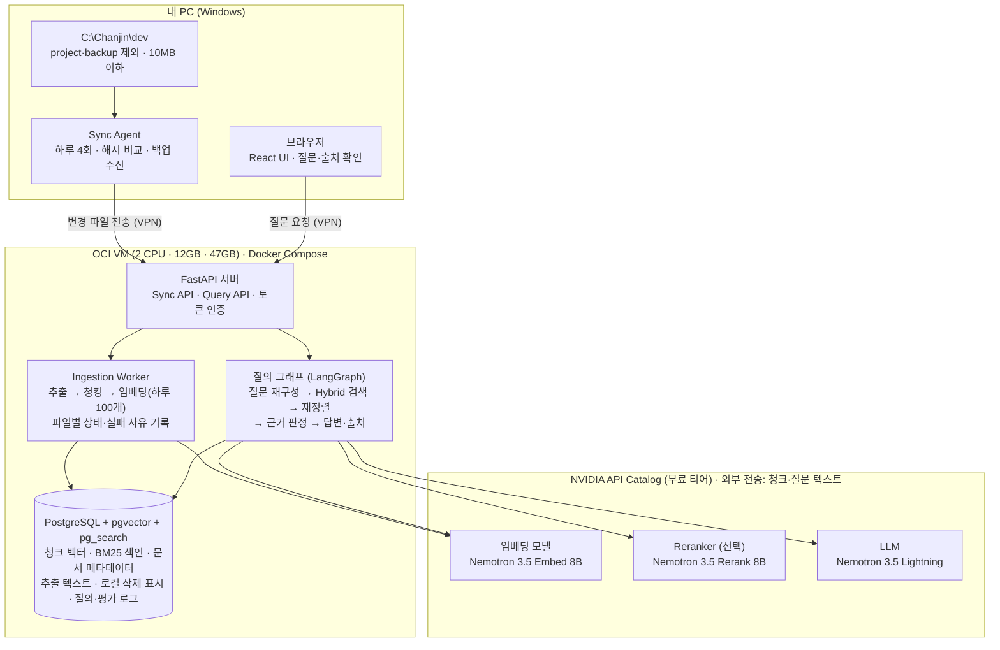

# 개인 문서 RAG 플랫폼 PRD

Nov 7, 2026 · @이찬진

## 1. 개요

내 Windows PC에서 직접 지정한 폴더 하위의 문서만 VPN 안의 OCI 클라우드 VM으로 동기화하고, 질문하면 근거 문서와 함께 답하는 1인용 RAG 플랫폼을 만듭니다. 기존에 계획한 개인 문서 RAG를 검색, 요약, 출처 표시까지 확장한 버전입니다.

**해결할 문제**

- 탐색기 검색은 파일명과 키워드 위주라 "작년 계약서의 위약금 조항" 같은 내용 질문에 답하지 못합니다.
- 문서가 PDF, HWP, Office 등 형식별로 흩어져 있어 한 번에 찾기 어렵습니다.
- 일반 챗봇에 문서를 붙여넣는 방식은 매번 수작업이고, 답의 근거를 확인하기 어렵습니다.

**제품 정의:** 지정한 폴더 하위 문서만 근거로 답하고, 근거가 없으면 "찾지 못했다"고 말하는 개인 문서 검색 에이전트입니다.

## 2. 목표와 비목표

MVP는 "내 문서에 대한 질문에 출처와 함께 답한다"는 한 가지를 입증하는 것이 목표입니다.

| ID | 목표 | 성공 기준 |
| --- | --- | --- |
| G1 | 내용 기반 질문에 출처와 함께 답한다 | 답변마다 파일 경로와 위치(페이지, 시트, 슬라이드, 문단, 줄 중 형식에 맞는 것) 표시 |
| G2 | 로컬 변경분만 자동으로 반영한다 | 파일 수정 후 다음 스케줄 실행 때 반영(하루 임베딩 한도 안에서) |
| G3 | 품질을 수치로 측정하고 개선한다 | 평가셋 30\~50문항으로 8장의 지표를 자동 측정 |
| G4 | 내 문서를 불필요하게 노출하지 않는다 | VPN 밖에서는 접속 불가, 외부 전송은 NVIDIA API 호출뿐 |

**비목표 (MVP 제외)**

- 다중 사용자와 사용자별 권한(ACL): 본인 1명만 사용합니다.
- 외부 테스터 2\~3명의 피드백: 본인 사용 로그와 답변 피드백으로 대신합니다.
- OCR(스캔 PDF, 이미지): 후속 후보로 둡니다.
- 로컬 LLM이나 임베딩 실행: 모두 클라우드 API를 씁니다.
- 문서 편집·생성, 모바일 앱, 이미지·오디오 검색.

## 3. 확정된 결정 사항

요구사항을 확인하면서 정한 내용입니다. 처음 구상한 프로세스와 달라진 점은 "영향" 열에 적었습니다.

| 항목 | 결정 | 영향 |
| --- | --- | --- |
| 사용자 | 본인 1명 | "권한 범위"는 "지정한 폴더 하위"로 해석하고, 로그인은 단일 계정으로 합니다 |
| 수집 범위 | C:\\Chanjin\\dev 폴더와 그 하위 문서만(C:\\Chanjin\\dev\\project와 백업 폴더 C:\\Chanjin\\dev\\backup은 제외) | 지정 위치 밖의 파일은 읽지 않습니다. 웹에서 루트를 추가해도 C:\\Chanjin\\dev 하위만 허용하고 서버가 검증합니다. project와 backup 제외는 고정값이라 웹에서 지울 수 없습니다. 10MB를 넘는 파일은 내용 없이 파일명만 색인합니다. 하위의 개발 폴더(.git, node\_modules, 가상환경)는 제외 패턴으로 뺍니다 |
| 배포 | OCI 프리 티어 Ampere A1(ARM64, 2 CPU, 12GB RAM), 오사카 리전, Oracle Linux 9(aarch64), 부트 볼륨 47GB(별도 블록 볼륨 없음), 기존 VM을 재사용하며 현재 다른 서비스 없이 이 플랫폼만 운영 + Docker Compose | 원본 파일은 텍스트 추출 후 삭제하고 추출 텍스트만 VM에 저장합니다(암호화 디스크). 서버 고정비가 없고, 모든 Docker 이미지를 arm64로 준비해야 합니다 |
| DB 백업 | VM에서 하루 한 번 암호화 덤프를 만들고, Sync Agent가 VPN으로 내 PC 로컬 디스크에 내려받아 7일치 보관 | VM이 회수돼도 PC의 백업으로 복구합니다. 백업 폴더는 C:\\Chanjin\\dev\\backup이며, 백업 파일이 다시 업로드되지 않도록 수집 대상에서 제외합니다 |
| 접근 | VPN 전용(Tailscale 등) | 공인 포트를 열지 않습니다. 로그인과 토큰은 2차 방어선입니다 |
| 동기화 | 로컬 Sync Agent, Windows 작업 스케줄러로 하루 4회 실행 | 예정 시각에 PC가 꺼져 있었으면 켜지는 즉시 실행합니다. 로컬에서 삭제된 파일은 서버에 30일간 남기고 "로컬 삭제됨"으로 표시한 뒤 영구 삭제합니다. 파일 이동은 삭제가 아니라 경로 변경으로 처리합니다. 인덱싱은 서버에서 합니다 |
| 서버 데이터 삭제 | 삭제 원인에 따라 다르게 처리 | 루트 해제나 제외 패턴 추가로 범위에서 빠진 문서는 설정을 저장할 때 바로 영구 삭제합니다(저장 전 삭제될 문서 수를 확인). 로컬 삭제 문서는 30일 뒤 자동 삭제하고, 그 전에 수동으로 영구 삭제할 수 있습니다. 한 번의 동기화에서 20%를 넘는 문서가 삭제로 판정되면 스캔 오류로 보고 판정을 보류합니다. 백업에는 최대 7일, 이미 NVIDIA로 보낸 텍스트는 되돌릴 수 없음을 화면에 알립니다 |
| 원본 파일 열기 | 출처 패널의 "폴더에서 보기"로 탐색기에서 파일 위치만 보여줌 | 브라우저는 로컬 파일을 열 수 없으므로 Sync Agent의 URL 프로토콜을 씁니다. 파일을 바로 실행하지는 않습니다(매크로 등 부작용 방지). Windows가 아닌 기기에서는 경로 복사만 제공합니다 |
| 임베딩 한도 | 하루 최대 100개 파일(파일 크기와 무관), 최근 수정순 처리, 매일 자정(한국 시간)에 초기화. BM25 색인은 한도 없이 먼저 | 초과분은 대기열에 남겨 다음 날 처리하고, 그동안에도 키워드 검색은 됩니다. 1,000개를 처음 색인하려면 최소 10일이 걸립니다. 같은 파일 버전은 재시도해도 한 번만 세고, 내용이 바뀌지 않은 청크는 기존 임베딩을 재사용해 한도를 쓰지 않습니다. 큰 파일로 API 한도를 넘지 않도록 내부에 하루 청크 상한을 두며, 값은 구축 초기 API 실측 후 정합니다 |
| 모델 | NVIDIA API Catalog 무료 API. LLM은 nvidia/nemotron-3.5-lightning-30b-a3b(OpenAI 호환 API, 추론 끔. 처음 정한 deepseek-v4.1-flash는 무료 서버 대기열로 첫 응답까지 60초 이상 걸려 2026-11-07 비교 후 변경), 임베딩은 Nemotron 3.5 Embed 8B(nvidia/nemotron-3.5-embed-8b, 문서는 input\_type=passage, 질문은 query), 재정렬은 Nemotron 3.5 Rerank 8B(모두 Free Endpoint) | 청크와 질문 텍스트가 외부로 나갑니다. 임베딩은 아래 일일 한도로 제한합니다 |
| 문서 형식 | PDF, TXT, MD, DOCX, HWP/HWPX, XLSX, PPTX | OCR은 후속 후보입니다 |
| 규모 | 지정 폴더 하위 약 1,000개 이하(수 GB 이하) | VM 1대와 PostgreSQL 1개로 충분합니다 |
| UI | React Web UI | FastAPI 백엔드와 API로 통신하며, 채팅, 출처 보기, 동기화 상태 화면을 제공합니다. 로그인은 세션 방식이고, 답변은 SSE로 스트리밍합니다 |
| 기술 스택 | Python, FastAPI, LangGraph(질의 흐름만), PostgreSQL + pgvector + pg\_search(BM25), React, Docker | 처음 구상에 React가 추가됐습니다 |
| BM25 구현 위치 | PostgreSQL 확장(ParadeDB pg\_search)으로 DB 안에서 BM25 검색 | 벡터 검색, BM25, 필터를 SQL 쿼리 하나로 처리하고 백업은 DB 하나로 끝납니다. 구축 초기에 arm64 동작을 확인하고, 안 되면 애플리케이션 내 색인(bm25s 등)으로 전환합니다 |
| 사용자 피드백 | 외부 테스터 없음 | 본인 사용 로그와 답변 피드백으로 대신합니다 |

## 4. 시스템 아키텍처

원본은 PC에만, 추출 텍스트는 VPN 안의 VM에, 청크와 질문만 외부 API로 갑니다.

Sync Agent는 변경분만 VPN을 통해 보내고, 원본은 PC에만 남고, VM에는 추출 텍스트와 색인만 저장됩니다. 외부로 나가는 것은 임베딩, 재정렬, 답변 생성에 필요한 청크와 질문 텍스트뿐입니다.

## 5. 처리 프로세스

수집은 변경분만 서버로 보내 파일 단위로 인덱싱하고, 질의는 근거가 부족하면 한 번 재검색한 뒤 "찾지 못했다"고 답합니다. LangGraph는 이 재검색 분기가 있는 질의 흐름에만 씁니다.

### 5.1 수집과 인덱싱 (Sync Agent → Ingestion Worker)

1. 동기화할 루트 폴더와 제외 패턴(예: `~$*.docx` 임시 파일, `node_modules`)을 지정합니다. 지정한 폴더 하위만 읽고, 그 밖의 파일은 수집하지 않습니다.
2. Windows 작업 스케줄러가 Sync Agent를 하루 4번 실행합니다. 예정 시각에 PC가 꺼져 있었으면 켜지는 즉시 실행합니다("예약된 시작 시간을 놓친 경우 가능한 빨리 작업 시작" 옵션). 경로, 크기, 수정 시각으로 후보를 고르고 SHA-256 해시로 변경을 확정합니다.
3. 신규·수정 파일은 업로드합니다. 이동한 파일(같은 해시가 다른 경로에서 사라짐)은 서버에서 경로만 바꿉니다. 삭제된 파일은 "로컬 삭제"로 표시해 30일간 검색 결과에 표시와 함께 남긴 뒤 영구 삭제합니다. 스캔 중 읽지 못한 폴더는 삭제로 판정하지 않습니다. 10MB를 넘는 파일은 업로드하지 않고 파일명과 경로만 보내, 파일명으로만 검색되게 합니다. 실패하면 로컬 큐에 남겨 재시도합니다.
4. Worker가 형식별 파서로 텍스트와 위치 정보(페이지, 시트, 슬라이드, 제목 계층)를 추출합니다. 추출이 끝난 원본 파일은 서버에서 삭제하고 추출 텍스트만 저장합니다.
5. 구조 기반으로 청킹합니다.
   - 제목과 문단 경계를 우선하고, 청크는 500\~800토큰에 10\~15%를 겹칩니다.
   - 표(XLSX, DOCX 표)는 행 묶음 단위로 자르고 청크마다 헤더를 반복합니다.
   - PPTX는 슬라이드 1장을 기본 단위로 하고 발표자 노트를 포함합니다.
6. NVIDIA 임베딩 API로 청크를 벡터화하고, 한국어 형태소 분석(Kiwi)으로 토큰화한 뒤 PostgreSQL의 pg\_search 확장으로 BM25 색인을 만듭니다. BM25 색인은 API를 쓰지 않으므로 한도 없이 바로 만듭니다. 임베딩은 하루 100개 파일까지만 처리하고(수정 파일 재임베딩도 1개로 셈, 같은 버전의 재시도는 다시 세지 않음, 질문 임베딩은 제외), 남은 파일은 최근 수정순 대기열에 두었다가 다음 날 이어서 처리합니다. 수정된 파일에서 내용이 그대로인 청크는 기존 임베딩을 재사용합니다.
7. 파일별 상태(대기, 처리 중, 완료, 텍스트 없음, 실패와 사유)를 기록합니다. 수정된 파일은 기존 청크를 한 트랜잭션으로 교체합니다. 처리 중에 새 버전이 올라오면 이전 버전의 처리 결과는 버립니다.

### 5.2 질의와 답변 (LangGraph 질의 그래프)

1. **질문 재구성:** 대화 맥락을 반영해 독립된 질문으로 바꾸고, 필요하면 키워드 질의를 추가로 만듭니다.
2. **Hybrid Search:** 벡터 검색(pgvector)과 BM25 검색(pg\_search)의 상위 결과를 SQL 쿼리 하나 안에서 RRF로 합칩니다. 아직 임베딩되지 않은 파일은 BM25로만 검색됩니다. 디렉터리, 형식, 수정일 필터를 적용합니다.
3. **재정렬(선택):** Nemotron 3.5 Rerank 8B로 후보를 다시 정렬해 상위 5\~8개를 고릅니다. 평가셋으로 사용 여부를 결정합니다.
4. **근거 판정:** 상위 청크가 답의 근거가 되는지 판단합니다. 부족하면 질의를 바꿔 한 번 재검색하고, 그래도 부족하면 "문서에서 찾지 못했다"고 답합니다. 이때 현재 검색 범위(의미 검색이 가능한 문서 수, 키워드로만 검색되는 문서 수, 적용한 필터)를 함께 보여줘, 문서가 없어서인지 아직 색인되지 않아서인지 구분할 수 있게 합니다.
5. **답변 생성:** 선택된 청크만 근거로 답하고, 문장마다 인용 번호를 답니다. 문서 내용은 지시가 아닌 자료로만 다룹니다. 근거끼리 내용이 다르면 각 문서의 수정일을 함께 밝힙니다.
6. **출처 표시와 기록:** 파일 경로, 페이지(시트, 슬라이드), 인용 구절을 보여주고, 질문·검색 결과·답변·지연 시간을 질의 로그에 저장합니다.

## 6. 기능 요구사항

MVP는 동기화, 검색·답변·출처, 평가셋, 실패 사례 기록, 첫 실행 안내와 데이터 삭제까지 15개 기능입니다. 나머지는 평가 결과를 보고 후속으로 진행합니다.

| ID | 영역 | 요구사항 | 단계 |
| --- | --- | --- | --- |
| F-01 | 동기화 | 동기화 루트 폴더 지정·해제(하위 폴더 포함, C:\\Chanjin\\dev 하위만), 제외 패턴 설정. 저장 전에 범위에서 빠져 삭제될 문서 수를 보여주고 확인받음 | MVP |
| F-02 | 동기화 | 작업 스케줄러로 실행되는 Sync Agent 스캔, 해시 기반 변경 탐지, 업로드, 로컬 삭제 표시 | MVP |
| F-03 | 동기화 | "지금 동기화" 수동 실행(Web UI, CLI) | MVP |
| F-04 | 수집 | 7개 형식의 텍스트와 위치 정보 추출, 10MB 초과 파일은 파일명만 색인 | MVP |
| F-05 | 수집 | 파일별 처리 상태와 실패 사유 조회, 실패 파일 재처리(다음 동기화 때 재업로드되므로 "다음 동기화 대기"로 표시) | MVP |
| F-06 | 수집 | 구조 기반 청킹, 임베딩, BM25 색인, 하루 100개 파일 임베딩 한도와 최근 수정순 대기열(BM25는 한도 없이 먼저 색인) | MVP |
| F-07 | 검색 | Hybrid Search와 필터(디렉터리, 형식, 수정일) | MVP |
| F-08 | 답변 | 근거 기반 답변과 문장별 인용, 근거 부족 시 "찾지 못함" 응답과 현재 검색 범위 안내 | MVP |
| F-09 | 답변 | 파일 단위 요약("이 문서 요약해줘"). 대상이 여러 개면 고르게 하고, 없거나 아직 텍스트가 없는 문서면 이유를 안내 | MVP |
| F-10 | UI | 출처 패널: 로컬 경로(복사), 위치, 수정일, 인용 구절, 추출 텍스트 보기, 로컬 삭제 여부 표시, "폴더에서 보기"(Windows) | MVP |
| F-11 | UI | 세션 단위 대화 이력, 대화 이름 변경과 삭제 | MVP |
| F-12 | 평가 | 답변 피드백(좋아요, 싫어요, 메모, "실제로는 문서에 있음")을 실패 사례로 저장. 실패 원인 분류는 나중에 검토하며 붙임 | MVP |
| F-13 | 평가 | 평가셋 실행 CLI와 지표 리포트, 이전 실행과 비교 | MVP |
| F-14 | 동기화 | 실시간 파일 감시(watchdog) | 후속 |
| F-15 | 수집 | OCR(스캔 PDF, 이미지) | 후속 |
| F-16 | 검색 | 임베딩·LLM 모델 교체 비교 실험 | 후속 |
| F-17 | 답변 | 여러 문서 비교·종합 요약 | 후속 |
| F-18 | UI | 첫 실행 체크리스트(토큰 발급, Agent 설치, 첫 동기화)와 채팅 화면의 색인 범위 표시(키워드 검색 가능 수, 의미 검색 가능 수, 완료 예상일) | MVP |
| F-19 | 수집 | 문서 영구 삭제: 범위에서 빠진 문서 즉시 삭제, 로컬 삭제 문서 30일 뒤 자동 삭제와 수동 삭제 | MVP |
| F-20 | 수집 | 특정 파일 우선 임베딩(대기열 앞으로) | 후속 |
| F-21 | 동기화 | Sync Agent 실패 시 Windows 알림(토큰 폐기, 서버 연결 실패) | 후속 |
| F-22 | UI | 휴대폰 화면 최적화(MVP는 화면이 깨지지 않는 수준까지) | 후속 |

## 7. 비기능 요구사항

보안의 핵심은 "VPN 밖에서는 서버가 보이지 않는다"입니다. 성능 수치는 초기 목표이며, 구축 초기에 NVIDIA API 지연 시간을 실측한 뒤 확정합니다.

**보안과 프라이버시**

- VM은 VPN 노드로만 접근하고, OCI 보안 목록(방화벽)에서 인바운드를 모두 막습니다. SSH도 VPN을 거칩니다.
- Web UI는 단일 계정 세션 로그인(HttpOnly 쿠키), Sync Agent는 전용 API 토큰을 씁니다. 토큰은 Windows 자격 증명 관리자에 저장합니다.
- VM 디스크를 암호화하고, DB 백업도 암호화해 보관합니다.
- 외부 전송은 NVIDIA API 호출뿐이며, 청크와 질문 텍스트로 한정합니다.
- 무료 API의 입력 데이터 보관·학습 사용 조건을 확인하기 전에는 민감한 디렉터리를 등록하지 않습니다.
- 답변 화면은 외부 이미지와 링크를 불러오지 않습니다. 모델이 만든 마크다운으로 문서 내용이 외부 주소에 실려 나가는 것을 막습니다.
- 애플리케이션 로그에는 문서 본문과 질문 원문을 남기지 않습니다(운영 기준). 질문 원문은 DB의 질의 로그에만 저장합니다.
- 백업 복호화용 개인키는 PC 외에 한 곳 이상(비밀번호 관리자 등)에 따로 보관합니다. PC가 고장 나면 VM의 백업도 풀 수 없기 때문입니다.

**성능 (초기 목표)**

- 질의 전체 p95 8초 이하, 첫 토큰 3초 이내(SSE 스트리밍).
- LLM을 빼고 검색만 따졌을 때 p95 500ms 이하.
- 파일 변경은 다음 스케줄 실행 때 반영하고, 하루 임베딩 한도를 넘으면 다음 날로 넘깁니다.
- 임베딩은 하루 최대 100개 파일로 제한합니다. 1,000개 초기 색인에는 최소 10일이 걸리고, 중단되면 이어서 진행합니다.

**비용**

- 모델 API는 무료 티어를 씁니다. VM은 OCI 프리 티어(2 CPU, 12GB RAM)를 써서 고정비가 없습니다.

**운영**

- `docker compose up` 한 번으로 api, worker, db, web(React 정적 빌드)이 뜨게 합니다.
- DB는 하루 한 번 암호화 백업하고, Sync Agent가 내 PC 로컬 디스크로 내려받아 7일치를 보관합니다.
- 모델 호출은 Provider 인터페이스로 감쌉니다. NVIDIA 무료 티어가 바뀌면 설정만 바꿔 다른 API로 교체합니다.
- 색인에 임베딩 모델명과 차원을 기록해, 모델이 바뀌면 재색인 대상을 알 수 있게 합니다.

## 8. 평가 계획과 검증 지표

내 문서로 만든 30\~50문항 평가셋을 변경할 때마다 다시 돌려, 아래 목표를 넘기면 MVP 완료로 봅니다. 문항마다 정답과 근거 청크(파일, 페이지)를 직접 라벨링합니다.

**평가셋 구성**

- 단일 문서 사실 질문: 약 40%
- 여러 문서를 종합하는 질문: 약 20%
- 표·슬라이드(XLSX, PPTX) 질문: 약 15%
- 답이 문서에 없는 질문("찾지 못함" 기대): 약 15%
- HWP/HWPX 문서 질문: 약 10%

| 지표 | 정의 | 측정 방법 | MVP 목표 |
| --- | --- | --- | --- |
| Recall@5 | 정답 근거 청크가 상위 5개에 들어온 비율 | 라벨과 자동 비교 | 0.80 이상 |
| MRR | 첫 정답 근거 순위의 역수 평균 | 자동 | 0.60 이상 |
| 근거 충실성 | 답변 주장 중 인용 청크로 뒷받침되는 비율 | LLM-as-judge, 표본 20% 수동 검수 | 0.90 이상 |
| 답변 정확도 | 정답과 일치하는 답변 비율(정답, 부분, 오답 3단계) | LLM-as-judge, 표본 20% 수동 검수 | 0.75 이상 |
| "찾지 못함" 정확도 | 답 없는 질문에 모른다고 답한 비율 | 자동 | 0.80 이상 |
| p95 응답 시간 | 질문부터 답변 완료까지 | 질의 로그 | 8초 이하 |
| 파싱 성공률 | 텍스트가 오류 없이 추출된 파일 비율 | 처리 상태 | 95% 이상 |
| 작업 시간 절감 | 같은 정보를 탐색기 검색과 비교해 찾는 시간 | 본인 과제 10개 실측 | 50% 이상 단축 |
| 작업 완료율 | 일상 질문 중 플랫폼만으로 해결한 비율 | 답변 피드백 로그(피드백을 남긴 답변 중 좋아요 비율, 피드백 비율도 함께 표시) | 70% 이상 |

**실패 사례 기록:** 오답, 모름 오판, 파싱 실패를 파싱, 청킹, 검색 누락, 재정렬, 생성 환각 5가지 유형으로 분류해 저장합니다. 답변 화면에서는 좋아요·싫어요와 메모만 받고, 유형 분류는 나중에 질의 로그를 보며 붙입니다. 자주 틀리는 사례는 평가셋에 추가해 회귀를 막습니다.

LLM-as-judge도 같은 NVIDIA 모델을 쓰면 점수가 후하게 나올 수 있어, 판정용 모델은 답변 모델과 다르게 고릅니다.

## 9. 리스크

가장 큰 리스크는 NVIDIA 무료 API입니다. 호출 한도와 모델 변경 가능성을 구축 초기에 먼저 확인합니다.

| 리스크 | 영향 | 대응 |
| --- | --- | --- |
| 무료 API 호출 한도·크레딧 | 초기 인덱싱 지연, 질의 실패 | 배치 임베딩, 재시도와 백오프, Provider 교체 가능하게 설계 |
| 외부 API로 문서 청크 전송 | 개인 문서 내용 노출 | 개인 학습용으로만 사용하고 수집 범위를 C:\\Chanjin\\dev로 한정, 민감한 파일은 제외 패턴으로 빼기 |
| 임베딩 모델 변경·종료 | 전체 재색인 필요 | 색인에 모델명 기록, 재색인 스크립트 준비 |
| HWP/HWPX 파싱 품질 | 한글 문서 누락, 표 깨짐 | 파서 후보를 비교하고 실패 사유를 기록, HWP 문항을 평가셋에 포함 |
| 한국어 BM25 토큰화 | 키워드 검색 품질 저하 | 형태소 분석기(Kiwi 등)로 사전 토큰화해 pg\_search에 넣고, pg\_search 내장 토크나이저와 평가셋으로 비교 |
| 표·슬라이드 청킹 | XLSX 수치 질문 오답 | 행 단위 청킹과 헤더 반복, 표 문항을 평가셋에 포함 |
| LLM-as-judge 편향 | 품질 지표 과대평가 | 판정 모델 분리, 표본 20% 수동 검수 |
| 하루 임베딩 100개 한도 | 초기 색인 10일 이상, 평가 시작이 늦어짐 | BM25로 키워드 검색을 먼저 제공, 평가셋은 먼저 임베딩되는 최근 문서로 구성 |
| OCI 프리 티어 유휴 인스턴스 회수 정책 | VM이 회수되면 서비스와 데이터 중단 | 구축 초기에 정책 확인, DB 백업을 내 PC 로컬 디스크에 보관 |
| ARM(Ampere) 인스턴스의 이미지 호환성 | 파서, pgvector, pg\_search 이미지 빌드 실패 | 구축 초기에 arm64 이미지로 전체 스택 기동 확인. pg\_search가 안 되면 애플리케이션 내 BM25 색인(bm25s 등)으로 전환 |
| 스캔 오류로 인한 대량 삭제 오판 | 멀쩡한 문서가 "로컬 삭제됨"이 되고 30일 뒤 사라짐 | 읽지 못한 폴더는 삭제 판정에서 제외, 한 번에 20%를 넘는 삭제 판정은 보류하고 경고 |
| 범위에서 뺀 문서가 남아 있음 | 민감한 파일을 뺐는데 계속 검색됨 | 범위 변경 저장 시 즉시 영구 삭제, 백업·외부 전송에 남는 범위를 화면에 안내 |
| 임베딩 차원이 pgvector 인덱스 한도를 넘음 | vector 타입은 2,000차원을 넘으면 HNSW 인덱스를 만들 수 없음 | 구축 초기에 임베딩 길이를 확인하고, 2,000을 넘으면 halfvec(4,000차원까지) 사용 |
