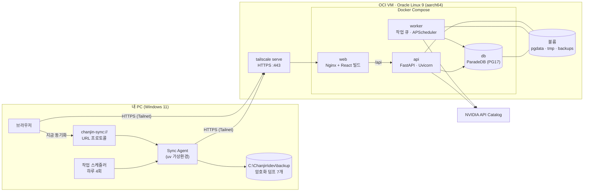
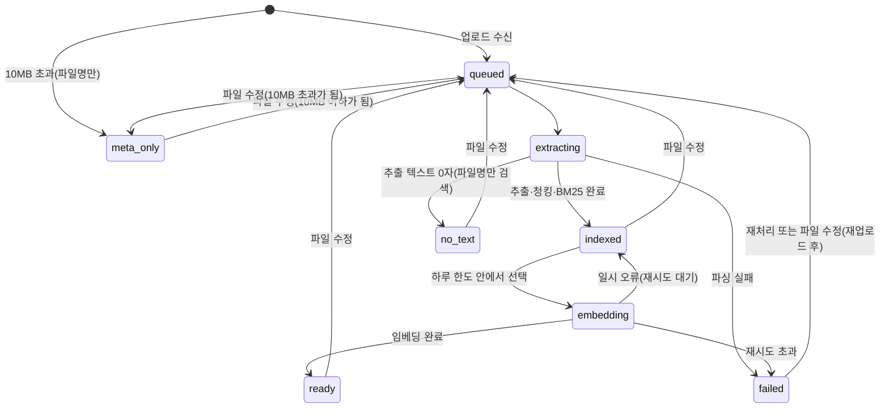
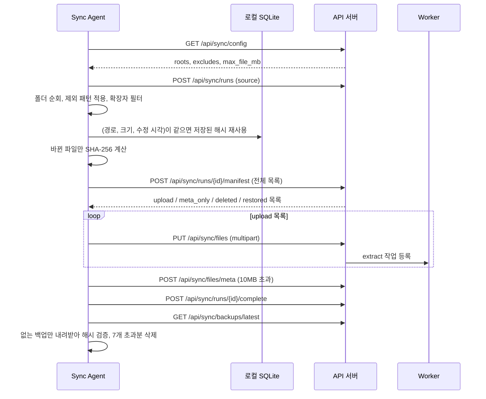
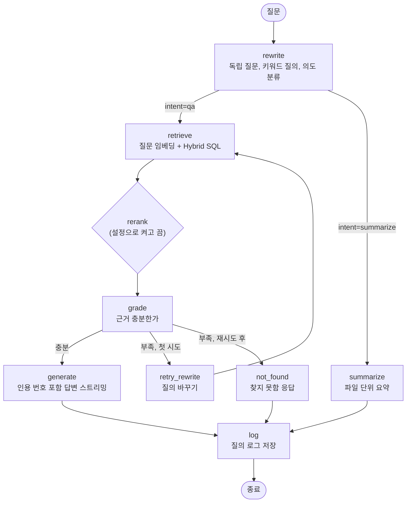

# 개인 문서 RAG 플랫폼 TRD

Nov 7, 2026 · @이찬진 · 기준 문서: [PRD.md](./PRD.md)

## 1. 개요

PRD에서 정한 기능을 어떤 기술로, 어떤 구조로 만들지 정한 기술 요구사항 문서입니다. 무엇을 만들지는 PRD를, 어떻게 만들지는 이 문서를 따릅니다. 두 문서가 어긋나면 PRD의 요구사항을 우선하고 이 문서를 고칩니다.

**설계 원칙**

- **컨테이너를 적게:** VM이 2 CPU·12GB이고 사용자가 1명이라 Redis, Celery, 별도 검색엔진을 두지 않습니다.
- **상태는 PostgreSQL 하나에:** 문서, 청크, 작업 대기열, 세션, 로그를 모두 DB에 두어 백업 하나로 복구가 끝나게 합니다.
- **arm64 우선:** 모든 이미지는 VM에서 직접 빌드하거나 arm64 공식 이미지를 씁니다.
- **모델 교체 가능:** LLM, 임베딩, 재정렬 호출은 Provider 인터페이스 뒤에 두고, 모델명과 엔드포인트는 설정값으로만 바꿉니다.

**PRD 대비 구체화한 내용**

| 항목 | 내용 |
| --- | --- |
| 웹의 "지금 동기화"(F-03) | VM은 PC를 깨울 수 없으므로, Sync Agent를 `chanjin-sync://` 사용자 지정 URL 프로토콜로 등록해 브라우저가 PC의 Agent를 직접 실행합니다 |
| 동기화 설정 위치 | 루트 폴더와 제외 패턴은 서버 DB에 저장하고, Agent가 실행할 때마다 받아 갑니다. 웹에서 바꾸면 다음 실행부터 반영됩니다. 루트는 `C:\Chanjin\dev` 하위만 허용하고, 고정 제외(`/project/`, `/backup/`)는 설정과 별개로 코드에 둡니다 |
| 변경 판정 | Agent가 전체 목록(manifest)을 보내고 서버가 업로드 대상을 정합니다. DB를 백업에서 복구해도 차이만 다시 올라옵니다 |
| 파일 이동 | 사라진 경로와 같은 해시의 새 경로가 같은 manifest에 있으면 문서의 경로만 바꿉니다. 옛 경로가 남아 있으면(복사) 청크를 복사합니다. 둘 다 하루 임베딩 한도를 쓰지 않습니다 |
| 문서 삭제 | 범위에서 빠진 문서는 설정 저장 시 즉시, 로컬 삭제 문서는 30일 뒤 영구 삭제합니다(6.5) |
| 원본 파일 위치 보기 | URL 프로토콜에 `reveal` 동작을 추가해 탐색기에서 파일을 선택한 상태로 엽니다. URL에는 경로 대신 해시만 넣습니다(10.2) |
| 임베딩 한도 차감 | 파일 버전(`document_id`, `sha256`)당 한 번만 차감하고, 내용이 같은 청크는 기존 임베딩을 재사용합니다. 하루 청크 상한을 안전장치로 둡니다(6.2) |
| 임베딩 차원 | 4,000차원을 넘으면 halfvec도 HNSW 색인이 안 되므로, 차원 축소 또는 바이너리 양자화로 대응합니다(6.3) |

## 2. 기술 스택

| 영역 | 기술 | 용도·비고 |
| --- | --- | --- |
| 언어 | Python 3.12, TypeScript | 백엔드·Agent·평가는 Python, 웹은 TypeScript |
| 패키지 | uv(workspace, lock 파일), pnpm | |
| API 서버 | FastAPI, Uvicorn, Pydantic v2, pydantic-settings | 설정은 `.env`에서 읽습니다 |
| SSE | sse-starlette | 답변 스트리밍 |
| DB | PostgreSQL 17(ParadeDB 공식 이미지), pgvector, pg\_search | 벡터, BM25, 필터를 SQL 하나로 처리 |
| DB 접근 | SQLAlchemy 2.0(async), psycopg 3, Alembic | Hybrid 검색 SQL은 직접 작성 |
| 작업 큐 | PostgreSQL `jobs` 테이블 + `SELECT … FOR UPDATE SKIP LOCKED` | 별도 브로커 없음 |
| 예약 작업 | APScheduler(Worker 안) | 자정 한도 초기화, 매일 백업, 로컬 삭제 문서 영구 삭제, 끊긴 동기화 실행 정리, 오래된 임시 파일 정리 |
| 질의 흐름 | LangGraph | LangChain 체인과 래퍼는 쓰지 않고 Provider를 직접 호출 |
| 모델 호출 | openai SDK(`base_url`=NVIDIA), httpx, tenacity | 재정렬은 OpenAI 호환이 아니어서 httpx로 호출 |
| 한국어 형태소 | kiwipiepy | BM25용 사전 토큰화 |
| 토큰 수 계산 | tiktoken(o200k\_base) 근사 | 청크 길이 기준. 실제 한도는 API의 `truncate=END`로 보호 |
| 문서 파서 | PyMuPDF, python-docx, openpyxl, python-pptx, lxml(HWPX), pyhwp(HWP), charset-normalizer | 3.4 참고 |
| 인증 | argon2-cffi | 비밀번호 해시 |
| 로그 | structlog(JSON, stdout) | 질의 로그는 DB에 저장 |
| CLI | Typer | 백엔드 관리, Agent, 평가 |
| 웹 | Vite, React, TypeScript, Tailwind CSS, React Router, TanStack Query, shadcn/ui | |
| 웹 부가 | react-markdown, remark-gfm, openapi-typescript | API 타입은 FastAPI OpenAPI에서 생성 |
| Sync Agent | httpx, keyring, SQLite(표준 라이브러리), pathspec, Typer | Windows 작업 스케줄러가 실행 |
| 백업 암호화 | age | VM에는 공개키만 둡니다 |
| 리버스 프록시 | Nginx | 정적 파일 서빙, `/api` 프록시 |
| 네트워크 | Tailscale(VM 호스트에 설치), `tailscale serve` | `*.ts.net` 인증서로 HTTPS |
| 배포 | Docker Compose | 이미지는 VM에서 직접 빌드 |
| 테스트·품질 | pytest, pytest-asyncio, ruff, mypy, Vitest, MSW, ESLint, Prettier | |

## 3. 시스템 구성

### 3.1 배포 구성



### 3.2 컨테이너

| 서비스 | 이미지 | 역할 | 메모리 상한(초기값) |
| --- | --- | --- | --- |
| db | ParadeDB 공식 이미지(arm64) | PostgreSQL 17 + pg\_search + pgvector | 4GB |
| api | `backend` 이미지 | REST API, SSE 답변, 업로드 수신 | 1.5GB |
| worker | `backend` 이미지(실행 명령만 다름) | 추출, 청킹, BM25 색인, 임베딩, 백업 | 3GB |
| web | Nginx(arm64) + React 빌드 결과 | 정적 파일, `/api` 프록시 | 128MB |
| migrate | `backend` 이미지(1회 실행) | `alembic upgrade head` 후 종료 | |

- `api`와 `worker`는 `migrate`가 성공한 뒤에 시작합니다(`depends_on: condition: service_completed_successfully`).
- 남는 약 3GB는 OS, Docker, Tailscale과 HNSW 색인 생성 시 여유분으로 둡니다.
- 볼륨:
  - `pgdata`: DB 데이터
  - `tmp`: 업로드 원본 임시 보관, 추출 후 삭제
  - `backups`: 암호화 덤프, VM에는 최근 3개만 유지

### 3.3 네트워크

- VM의 OCI 보안 목록은 인바운드를 모두 막습니다. Tailscale은 아웃바운드와 NAT 통과만으로 연결됩니다.
- Compose는 공개 포트를 열지 않고, `web`만 `127.0.0.1:8080`에 바인딩합니다. `tailscale serve --https=443 http://127.0.0.1:8080`으로 Tailnet 안에만 노출합니다.
- SSH는 Tailscale SSH 또는 Tailscale IP에만 바인딩한 sshd로 접속합니다.
- Tailscale ACL은 내 기기(PC, 휴대폰 등)만 VM의 443 포트에 접근하도록 제한합니다.
- 외부로 나가는 연결은 NVIDIA API(`integrate.api.nvidia.com` 등), Tailscale, OS·이미지 업데이트뿐입니다.

### 3.4 문서 파서

| 형식 | 라이브러리 | 위치 정보 | 비고 |
| --- | --- | --- | --- |
| PDF | PyMuPDF | 페이지 | 텍스트 레이어가 없는 페이지는 "스캔본 의심"으로 기록하고 건너뜁니다(OCR은 후속). AGPL이지만 배포하지 않는 개인 용도라 문제없습니다 |
| DOCX | python-docx | 제목 계층, 표 번호 | 문단 스타일(Heading 1\~n)로 제목 계층을 만들고, 표는 행 단위로 따로 추출 |
| XLSX | openpyxl(read-only, data\_only) | 시트, 행 범위 | 첫 비어 있지 않은 행을 헤더로 보고, 수식은 계산된 값으로 읽습니다 |
| PPTX | python-pptx | 슬라이드 번호 | 제목, 본문 도형, 표, 발표자 노트 순서로 추출 |
| HWPX | zipfile + lxml | 구역, 문단 | `Contents/section*.xml`의 문단과 표를 직접 해석 |
| HWP | pyhwp(hwp5txt 계열) | 문단(페이지 없음) | 품질 리스크가 가장 큰 형식입니다. 구축 초기에 내 파일로 비교합니다(13장) |
| TXT, MD | charset-normalizer | 줄 범위, MD 제목 | 한국어 Windows 파일은 cp949가 많아 인코딩을 먼저 판별합니다 |

파서는 `Parser` 인터페이스를 구현하고, 결과는 공통 형식인 `Section(location, heading_path, text, kind)` 목록으로 반환합니다. `kind`는 `text`, `table`, `slide` 중 하나입니다. 파서마다 타임아웃(60초)과 메모리 상한을 둡니다. 실패하면 사유 코드와 함께 문서를 `failed`로 기록합니다.

**실패 사유 코드(`failure_code`)**

| 코드 | 의미 | 화면 안내 |
| --- | --- | --- |
| `encrypted` | 암호가 걸린 파일 | 암호를 풀고 저장하면 다음 동기화 때 다시 처리됩니다 |
| `corrupted` | 파일 손상, 형식 불일치 | 파일을 다시 저장해 보세요 |
| `timeout` | 파싱 60초 초과 | 재처리하거나 파일을 나눠 보세요 |
| `memory` | 메모리 상한 초과 | 재처리하거나 파일을 나눠 보세요 |
| `hash_mismatch` | 업로드 중 파일이 바뀜 | 다음 동기화 때 자동으로 다시 올라옵니다 |
| `parser_error` | 그 밖의 파서 예외(`failure_detail`에 메시지) | 재처리하세요. 반복되면 파서 문제입니다 |

- XLSX를 Excel 외 도구로 저장해 수식의 계산값이 없으면 빈 값 대신 수식 문자열을 넣고, 문서에 경고를 남깁니다.
- 추출 결과 텍스트가 0자(완전 스캔 PDF, 빈 문서)면 실패가 아니라 `no_text` 상태로 두고, 파일명 청크 1개만 만들어 파일명으로 검색되게 합니다.

## 4. 저장소 구조

uv workspace 하나로 `backend`, `agent`, `eval`을 묶고, 웹은 pnpm으로 따로 관리합니다.

```
chanjin-rag/
├─ backend/                 # api, worker 공용 패키지
│  ├─ app/
│  │  ├─ api/               # FastAPI 라우터 (auth, sync, documents, chat, eval, health)
│  │  ├─ core/              # 설정, 로깅, 보안(세션, 토큰)
│  │  ├─ db/                # SQLAlchemy 모델, 세션, 검색 SQL
│  │  ├─ ingest/            # parsers/, chunking/, tokenize(Kiwi)
│  │  ├─ query/             # LangGraph 그래프, 노드, 프롬프트
│  │  ├─ providers/         # LLM, Embedding, Reranker 인터페이스와 NVIDIA 구현, Fake 구현
│  │  ├─ jobs/              # 작업 큐, Worker 루프, 예약 작업
│  │  └─ cli.py             # create-user, reset-password, create-token, reindex, purge 등
│  ├─ alembic/
│  └─ tests/
├─ agent/                   # Windows Sync Agent
│  ├─ rag_agent/            # scan, manifest, upload, backup, protocol(run·reveal), install
│  └─ tests/
├─ eval/                    # 평가 CLI와 평가셋
│  ├─ rag_eval/
│  └─ datasets/             # 평가셋 YAML (Git으로 관리)
├─ web/                     # Vite + React + TypeScript
├─ deploy/
│  ├─ compose.yaml
│  ├─ nginx.conf
│  ├─ postgres/             # postgresql.conf 조정값, 초기화 SQL
│  └─ scripts/              # backup, restore, deploy
├─ docs/                    # PRD.md, TRD.md
├─ .env.example
└─ pyproject.toml           # uv workspace 루트
```

## 5. 데이터 모델

모든 시각은 `timestamptz`로 저장하고, 화면과 일일 한도 계산은 `Asia/Seoul` 기준으로 합니다. 테이블과 핵심 컬럼만 적고, 상세 DDL은 Alembic 마이그레이션이 기준입니다.

### 5.1 수집

| 테이블 | 핵심 컬럼 | 설명 |
| --- | --- | --- |
| `sync_config` | `roots jsonb`, `excludes jsonb`, `max_file_mb int`(기본 10), `updated_at` | 단일 행. Agent가 실행할 때마다 받아 감. 고정 제외는 여기에 넣지 않고 코드에 둠. `max_file_mb`는 웹에서 바꾸지 않음(Nginx 업로드 상한과 함께 바꿔야 하므로) |
| `documents` | `id`, `path`, `path_key`(NFC 정규화 후 소문자, unique), `filename`, `ext`(소문자), `size`, `mtime`, `sha256`, `status`, `failure_code`, `failure_detail`, `content_indexed bool`, `locally_deleted bool`, `deleted_at`, `needs_upload bool`, `embed_charged_sha256`, `embed_model`, `embed_dim`, `created_at`, `updated_at` | 파일 1개 = 1행. `path`는 원래 Windows 경로를 그대로 보관. `embed_charged_sha256`은 한도를 이미 차감한 버전 |
| `sections` | `id`, `document_id`, `seq`, `location jsonb`, `heading_path text[]`, `kind`, `text` | 추출 텍스트 원본. 재청킹은 여기서 다시 하므로 재업로드가 필요 없음 |
| `chunks` | `id`, `document_id`, `seq`, `location jsonb`, `heading_path`, `content`, `content_sha256`, `bm25_text`, `token_count`, `embedding halfvec(N)`(NULL 허용), `embed_model` | 검색 단위. `bm25_text`는 Kiwi 토큰을 공백으로 이은 문자열. `content_sha256`은 임베딩 입력(머리말 포함)의 해시로, 임베딩 재사용에 씀 |
| `jobs` | `id`, `type`, `document_id`, `sha256`, `status`, `priority`, `attempts`, `run_after`, `locked_at`, `last_error` | `type`: `extract`, `index`, `embed`. `priority`는 파일 수정 시각. `sha256`은 작업 대상 버전으로, 끝날 때 문서의 현재 해시와 다르면 결과를 버림 |
| `embed_quota` | `day date`(PK), `used int`, `chunks_used int` | 한국 시간 기준 날짜별 사용량(파일 수, 청크 수). 새 날짜 행이 생기면 자연스럽게 초기화 |
| `sync_runs` | `id`, `source`(`schedule`·`web`·`cli`), `started_at`, `finished_at`, `heartbeat_at`, `status`(`running`·`succeeded`·`failed`·`abandoned`), `stats jsonb` | 동기화 실행 이력. 웹의 상태 화면이 사용. `stats`에 업로드 수, 지원하지 않는 형식으로 건너뛴 수, 읽지 못한 폴더, 보류된 삭제 판정을 담음 |

**`location` 예시:** `{"page": 3}`, `{"sheet": "매출", "rows": [2, 41]}`, `{"slide": 7}`, `{"lines": [120, 168]}`

**문서 상태**



- `locally_deleted`는 상태와 별개인 표시값입니다. 로컬에서 지워져도 30일간 검색은 되고, 결과에 "로컬 삭제됨"을 붙입니다. 이후 영구 삭제됩니다(6.5).
- 어느 상태에서든 파일이 수정되면(새 `sha256`) 진행 중인 작업은 끝날 때 결과를 버리고, 새 버전으로 `queued`부터 다시 시작합니다.
- 화면의 "처리 중"은 `extracting`, `embedding`을, "BM25만"은 `indexed`를, "텍스트 없음"은 `no_text`를 뜻합니다.

### 5.2 인증

| 테이블 | 핵심 컬럼 | 설명 |
| --- | --- | --- |
| `users` | `id`, `username`, `password_hash`, `failed_logins`, `locked_until` | 1행. `backend create-user` CLI로만 생성 |
| `sessions` | `id_hash`, `user_id`, `expires_at`, `last_seen_at` | 쿠키 값의 SHA-256만 저장 |
| `api_tokens` | `id`, `name`, `token_hash`, `last_used_at`, `revoked_at` | Sync Agent용. `backend create-token` CLI로 발급 |

### 5.3 대화, 로그, 평가

| 테이블 | 핵심 컬럼 | 설명 |
| --- | --- | --- |
| `conversations` | `id`, `title`, `created_at`, `updated_at` | F-11. `title`은 첫 질문 앞 40자로 정하고 사용자가 바꿀 수 있음. 삭제하면 메시지, 질의 로그, 피드백도 함께 삭제 |
| `messages` | `id`, `conversation_id`, `role`, `content`, `citations jsonb`, `status`, `created_at` | `status`: `streaming`, `complete`, `aborted`, `error`. `citations`: 번호별 `chunk_id`, `document_id`, 경로, 위치, 수정일, 인용 구절. 화면은 저장된 값으로 그리므로 청크가 바뀌어도 인용은 남음 |
| `query_logs` | `id`, `message_id`, `rewritten_query`, `keyword_query`, `filters`, `retrieved jsonb`, `grade`, `retried bool`, `not_found bool`, `coverage jsonb`, `latency_ms jsonb`, `models jsonb` | `retrieved`: 후보별 RRF 점수, 재정렬 점수, 순위. `coverage`: 질의 시점의 검색 범위. `latency_ms`: 단계별 지연 |
| `feedback` | `id`, `message_id`(unique), `rating`(+1·-1), `reason`, `note`, `failure_type`, `reviewed_at` | 답변당 1개이며 다시 누르면 바뀜. `reason`: `wrong`, `not_found_wrong`(실제로는 문서에 있음), `other`, NULL. `failure_type`(NULL 허용, 검토할 때 분류): `parse`, `chunk`, `retrieval`, `rerank`, `hallucination` (F-12) |
| `eval_runs` | `id`, `dataset_version`, `git_sha`, `config jsonb`, `metrics jsonb`, `started_at`, `finished_at` | F-13 |
| `eval_results` | `run_id`, `item_id`, `retrieved jsonb`, `answer`, `scores jsonb` | 문항별 결과 |

평가셋 문항 자체는 DB가 아니라 `eval/datasets/*.yaml`에서 Git으로 관리합니다. 정답 근거는 청크 ID가 아니라 `(경로, 위치)`로 적습니다. 청킹 방식이 바뀌어 청크 ID가 달라져도 라벨을 다시 달 필요가 없습니다. 파일을 옮기거나 지워 라벨의 경로가 `documents`에 없으면, `rag-eval`이 실행 전에 해당 문항을 경고로 보여주고 지표에서 뺍니다.

### 5.4 색인

| 대상 | 색인 | 비고 |
| --- | --- | --- |
| `chunks.embedding` | HNSW(`halfvec_cosine_ops`), `m=16`, `ef_construction=64` | 필터와 같이 쓸 때 결과가 모자라지 않게 `hnsw.iterative_scan`을 켭니다 |
| `chunks.bm25_text` | pg\_search BM25 색인, 공백(whitespace) 토크나이저 | Kiwi가 이미 토큰화했으므로 DB에서는 공백으로만 자릅니다. 함께 `filename`, `heading_path`도 색인 |
| `documents` | `path_key` unique, `sha256`, `(status)`, `(locally_deleted)` | |
| `jobs` | `(status, type, priority DESC)` | 큐 선택용 |

pg\_search의 색인 생성 문법과 토크나이저 설정은 버전마다 바뀌어 왔습니다. 구축 초기 검증(13장)에서 쓰는 이미지 버전 기준으로 확정합니다.

## 6. 수집 파이프라인

### 6.1 Sync Agent 실행 흐름



**변경 판정은 서버가 합니다.** manifest의 각 항목(`path`, `size`, `mtime`, `sha256`)을 `documents`와 비교합니다.

위에서부터 순서대로 판정합니다.

| 경우 | 서버 판정 |
| --- | --- |
| 새 경로이고, 같은 해시의 기존 문서 경로가 이번 manifest에 없음 | 이동(`moved`). 기존 문서의 `path`만 새 경로로 바꿈. 업로드 없음, 한도 사용 없음 |
| 새 경로이고, 같은 해시의 기존 문서 경로도 manifest에 있음 | 복사. 기존 sections·chunks·임베딩을 새 문서로 복사. 업로드 없음, 한도 사용 없음 |
| 새 경로이거나 해시가 다름 | 10MB 이하면 `upload`, 초과면 `meta_only` |
| 해시가 같음 | 아무것도 안 함(수정 시각만 갱신) |
| `needs_upload=true`(재처리 요청된 실패 파일) | `upload` |
| DB에는 있고 manifest에 없으며, 읽지 못한 폴더(`scan_errors`) 아래가 아님 | `locally_deleted=true`, `deleted_at` 기록 |
| DB에는 있고 manifest에 없으나, 읽지 못한 폴더 아래임 | 판정 보류(그대로 둠) |
| `locally_deleted`인데 manifest에 다시 나타남 | 표시 해제(`restored`) |

- manifest에는 파일 목록과 함께 `scan_errors`(권한 오류 등으로 읽지 못한 폴더 목록)를 보냅니다.
- **대량 삭제 보호:** 이번 실행에서 새로 삭제로 판정된 문서가 전체 문서의 20%(`MASS_DELETE_GUARD_RATIO`)를 넘으면 삭제 판정을 모두 보류하고, `sync_runs.stats`에 기록해 동기화 화면에 경고를 띄웁니다. 사용자가 화면에서 "삭제 판정 적용"을 누르면 다음 실행 때 적용합니다.
- 업로드 시 서버가 다시 계산한 해시가 manifest와 다르면(업로드 사이에 파일이 바뀜) 저장하지 않고 `hash_mismatch`로 응답합니다. Agent는 다음 실행에서 자연스럽게 다시 올립니다.

**Agent 쪽 규칙**

- 동시에 한 인스턴스만 실행합니다(Windows 이름 있는 뮤텍스). 이미 실행 중이면 바로 종료합니다.
- 실행 중에는 1분마다 `sync_runs.heartbeat_at`을 갱신합니다. 서버는 10분 넘게 갱신이 없는 `running` 실행을 `abandoned`로 바꿉니다(PC 절전, 강제 종료).
- 업로드 실패는 로컬 SQLite 재시도 큐에 남기고, 다음 실행에서 manifest 판정을 다시 받아 자연스럽게 재시도합니다. 판정 후 업로드 전에 사라진 파일은 건너뜁니다.
- 다른 프로그램이 잠근 파일(열려 있는 Excel 등)은 이번 실행에서 건너뛰고 manifest에도 넣지 않습니다. 삭제로 오판하지 않도록 `scan_errors`에 파일 경로로 넣습니다.
- 고정 제외(코드에 있음, 웹에서 지울 수 없음): `/project/`, `/backup/`. `C:\Chanjin\dev` 기준이며 앞의 `/`가 있어야 하위의 같은 이름 폴더를 빼지 않습니다.
- 기본 제외 패턴(gitignore 문법, 웹에서 편집 가능): `.git/`, `node_modules/`, `.venv/`, `venv/`, `__pycache__/`, `~$*`, `*.tmp`.
- 지원 확장자(`.pdf .txt .md .docx .hwp .hwpx .xlsx .pptx`)만 대소문자 구분 없이 manifest에 넣습니다. 그 밖의 형식(`.doc`, `.xls`, `.ppt` 등)은 건너뛴 수를 형식별로 `stats`에 남겨 화면에 보여줍니다.
- 경로는 NFC로 정규화해 보냅니다.
- 수집 루트 밖의 경로는 심볼릭 링크라도 따라가지 않습니다.

### 6.2 Worker 처리

Worker는 하나의 프로세스에서 작업 루프와 APScheduler를 함께 돌립니다. 작업은 `SELECT … FOR UPDATE SKIP LOCKED`로 하나씩 가져가고, `locked_at`이 10분 넘게 갱신되지 않은 작업은 중단된 것으로 보고 다시 대기열에 넣습니다. 작업 결과를 저장하는 트랜잭션에서 `jobs.sha256`이 문서의 현재 `sha256`과 다르면 결과를 버리고 작업을 끝냅니다(처리 중에 새 버전이 올라온 경우).

| 단계 | 작업 | 한도 | 내용 |
| --- | --- | --- | --- |
| 1 | `extract` | 없음 | 임시 원본을 파싱해 `sections`를 저장하고, 원본 파일을 삭제. 실패해도 원본은 삭제하고 `failed`와 사유를 기록 |
| 2 | `index` | 없음 | 청킹, Kiwi 토큰화, `chunks` 교체(한 트랜잭션). 이 시점부터 BM25로 검색됨. 이어서 `embed` 작업 등록 |
| 3 | `embed` | 하루 100개 파일 | 최근 수정순으로 선택. 청크를 `EMBED_BATCH_SIZE`개씩 묶어 임베딩 API 호출. 무료 엔드포인트는 여러 문장 묶음에 500을 돌려주므로 기본 1개(13장 실측), 묶음 요청이 500이면 반으로 나눠 다시 보냄 |

**하루 임베딩 한도**

- `embed` 작업을 가져갈 때 같은 트랜잭션에서 `embed_quota`의 오늘(한국 시간) `used`를 확인합니다. 문서의 `embed_charged_sha256`이 작업의 `sha256`과 같으면 이미 차감한 버전이므로 세지 않고 시작합니다. 다르면 `used`가 100 미만일 때만 1 올리고 `embed_charged_sha256`을 기록한 뒤 시작합니다.
- 한도는 버전마다 한 번, 작업을 가져갈 때 차감하고, 실패해도 돌려주지 않습니다. 429로 반납했다가 다시 가져가도 같은 버전이면 다시 세지 않습니다. API 호출량을 넘기지 않는 것이 우선입니다.
- **청크 재사용:** 같은 문서의 이전 청크 중 `content_sha256`과 `embed_model`이 같은 것이 있으면 그 벡터를 복사하고 API를 부르지 않습니다. 새 버전의 모든 청크가 재사용되면 한도를 차감하지 않습니다. 이를 위해 `index` 단계는 이전 청크의 `(content_sha256, embedding)`을 남겨 두었다가 교체 트랜잭션 안에서 바로 채웁니다. 모든 청크가 채워지면 `embed` 작업 없이 바로 `ready`가 됩니다. 그래서 일부만 고친 파일은 한도에 막혀도 대부분의 청크가 계속 의미 검색됩니다.
- **하루 청크 상한(안전장치):** 실제로 API로 보낸 청크 수를 `embed_quota.chunks_used`에 더합니다. `EMBED_DAILY_CHUNK_LIMIT`을 넘으면 파일 한도가 남아 있어도 `embed`를 다음 날까지 쉽니다. 진행 중인 파일은 끝까지 처리합니다. 기본값은 13장 3번(API 한도 실측) 뒤에 정하고, 그 전에는 제한 없음(0)입니다.
- 한도에 도달하면 `embed` 작업은 다음 날 0시(한국 시간)까지 쉬고, `extract`와 `index`는 계속 처리합니다.
- 수정 파일의 재임베딩도 1개로 셉니다. 질문 임베딩은 세지 않습니다.
- 한도 값은 `EMBED_DAILY_FILE_LIMIT` 설정으로 바꿀 수 있습니다.

**재시도:** API 오류(429, 5xx, 타임아웃)는 tenacity로 지수 백오프합니다(최대 5회, 최대 대기 60초). 429가 계속되면 해당 작업을 `run_after`를 30분 뒤로 미뤄 반납합니다.

### 6.3 청킹과 임베딩

**청킹 규칙(PRD 5.1의 구현)**

- 같은 `heading_path` 안의 문단을 이어 붙여 500\~800토큰으로 만들고, 앞 청크 끝 10\~15%를 겹칩니다. 문단 중간에서는 자르지 않되, 한 문단이 800토큰을 넘으면 문장 단위로 자릅니다.
- 청크 앞에 `[파일명 > 제목 > 소제목]` 머리말을 붙여 임베딩합니다. 화면에 보여주는 `content`에는 넣지 않습니다.
- 표: 헤더 행 + 데이터 행 묶음(최대 약 600토큰)을 `헤더: 값 | 헤더: 값` 형태 텍스트로 바꿉니다. 청크마다 헤더를 반복합니다.
- PPTX: 슬라이드 1장 = 청크 1개(800토큰을 넘으면 나눔), 발표자 노트를 포함합니다.
- `meta_only`, `no_text` 문서: 파일명과 경로만 담은 청크 1개를 만들어 BM25로만 검색되게 합니다.

**임베딩 호출**

- 문서 청크는 `input_type=passage`, 질문은 `input_type=query`로 호출하고 `truncate=END`를 씁니다. 예제의 `extra_body` 형식을 그대로 따릅니다. 예제에 있던 `modality` 값은 텍스트 전용 값을 문서에서 확인해 설정합니다.
- API 키는 모델마다 따로 발급되므로 `NVIDIA_LLM_API_KEY`, `NVIDIA_EMBED_API_KEY`, `NVIDIA_RERANK_API_KEY`를 각 Provider가 자기 것만 읽습니다. 예제처럼 `"$NVIDIA_API_KEY"` 문자열을 그대로 넣으면 인증이 실패합니다.
- 청크마다 `embed_model`을 기록하고, 문서에는 모델명과 차원을 기록합니다. 설정의 모델이 바뀌면 `backend reindex --embeddings` 대상이 됩니다.

**벡터 컬럼 타입 결정**

| 실제 임베딩 차원 | 컬럼 | 색인 |
| --- | --- | --- |
| 2,000 이하 | `vector(N)` | HNSW |
| 2,001\~4,000 | `halfvec(N)` | HNSW |
| 4,000 초과 | ① API가 차원 축소(`dimensions` 등)를 지원하면 2,048 등으로 줄여 `halfvec` 사용<br/>② 안 되면 `halfvec(N)`에 저장하고, 바이너리 양자화 식(`binary_quantize`)으로 HNSW 색인을 만들어 후보를 뽑은 뒤 원래 벡터로 다시 정렬 | ① 우선 |

1,000개 파일 규모면 청크가 수만 개 수준이라, 최악의 경우 색인 없이 전수 비교해도 검색 목표(p95 500ms)를 맞출 가능성이 있습니다. 구축 초기에 실제 차원을 확인하고 표에 따라 결정합니다.

### 6.4 한국어 BM25 토큰화

- Kiwi로 형태소를 분석해 명사(NNG, NNP, NNB), 동사·형용사 어간(VV, VA), 외국어(SL), 숫자(SN), 한자(SH), 어근(XR)만 남기고 조사와 어미는 버립니다.
- 영문은 소문자로 바꾸고, 복합명사는 원형과 분해형을 모두 넣습니다(예: "위약금조항" → `위약금조항 위약금 조항`).
- 질문도 같은 함수로 토큰화합니다. 문서와 질문 토큰화가 어긋나면 BM25 품질이 바로 떨어지므로, 토큰화 함수는 하나만 둡니다.
- 사용자 사전(`deploy/kiwi_user_dict.txt`)으로 프로젝트명, 고유명사를 추가할 수 있게 합니다. 사전을 바꾸면 `backend reindex --bm25`로 다시 색인합니다(API 호출 없음).
- 평가셋으로 pg\_search 내장 한국어 토크나이저와 비교해, 더 나은 쪽을 남깁니다(PRD 9장 리스크).

### 6.5 문서 삭제와 보관

| 원인 | 시점 | 처리 |
| --- | --- | --- |
| 루트 해제, 제외 패턴 추가 | `PUT /settings/sync` 저장 시 | 새 설정에 맞지 않는 문서를 즉시 영구 삭제. 저장 전에 `POST /settings/sync/preview`로 삭제될 문서 수와 예시 경로를 보여주고 확인받음 |
| 로컬 삭제 | `deleted_at`부터 30일(`LOCAL_DELETED_RETENTION_DAYS`) | Worker의 APScheduler가 매일 04:00에 기간이 지난 문서를 영구 삭제 |
| 사용자 요청 | 문서 화면에서 "영구 삭제" | `DELETE /documents/{id}`로 즉시 삭제 |

- **영구 삭제 범위:** `documents`, `sections`, `chunks`, 관련 `jobs`, `tmp`의 임시 원본입니다.
- **예전 대화의 인용:** 범위 제외와 사용자 요청으로 삭제한 문서는 프라이버시 때문에 지운 것이므로, `messages.citations`의 인용 구절도 "삭제된 문서"로 바꿉니다. 로컬 삭제 30일 경과로 지운 문서는 인용을 그대로 둡니다.
- **질의 로그:** `query_logs.retrieved`에는 청크 ID와 점수만 있으므로 그대로 둡니다.
- **확인 문구:** 범위 제외와 사용자 삭제의 확인 창에 "백업 파일에는 최대 7일(PC)까지 남습니다. 이미 NVIDIA API로 보낸 텍스트는 되돌릴 수 없습니다."를 표시합니다.
- **로그:** 삭제는 `documents.purged` 구조화 로그 이벤트로 남깁니다(원인, 개수만, 경로 제외).

## 7. 질의 파이프라인

### 7.1 LangGraph 그래프



**그래프 상태(`QueryState`):** `question`, `history`(최근 6턴), `filters`, `rewritten`, `keyword_query`, `intent`, `target_document_id`, `candidates`, `selected`, `grade`, `attempt`, `answer`, `citations`, `timings`

| 노드 | 입력 → 출력 | 구현 메모 |
| --- | --- | --- |
| rewrite | 질문·이력 → 독립 질문, 키워드 질의, 의도 | 이력이 없으면 LLM을 부르지 않고 그대로 통과(지연 절약). 출력은 JSON으로 받고, 파싱 실패 시 원문 질문 사용 |
| retrieve | 독립 질문 → 후보 30개 | 질문 임베딩과 Kiwi 토큰을 만들어 7.2의 SQL 실행 |
| rerank | 후보 30개 → 상위 8개 | `RERANK_ENABLED=false`면 RRF 상위 8개를 그대로 사용. 사용 여부는 평가셋으로 결정 |
| grade | 상위 청크 → 충분·부족 | 1차는 LLM 판정(짧은 JSON 응답). 지연이 목표를 넘으면 재정렬 점수 임계값으로 바꿉니다 |
| retry\_rewrite | 판정 사유 → 새 질의 | 동의어, 상위 개념, 키워드 위주로 바꿉니다. 재검색은 1회만 |
| generate | 선택된 청크 → 답변 | 청크를 `[1]`\~`[k]`로 번호 붙여 넣고, 문장 끝마다 인용 번호를 달게 지시. 근거 밖 지식 사용 금지. 청크는 구분자로 감싸 "자료"로 넣고, 그 안의 지시문은 따르지 않게 지시. 근거끼리 내용이 다르면 각 출처의 수정일을 밝히게 지시. 답변은 질문과 같은 언어로 작성 |
| summarize | 대상 문서 → 요약 | 대상은 질문에 나온 파일명, 직전 답변의 출처("그 문서"), 출처 패널의 "요약" 버튼 순으로 정합니다. 문서가 길면 sections를 묶어 부분 요약 후 합치기(map-reduce). 대상 판정 규칙은 아래 표 |
| not\_found | → 고정 응답 | "문서에서 찾지 못했습니다"와 함께 현재 검색 범위(`coverage`)와 가장 가까웠던 후보 3개를 참고로 보여줌 |
| log | 상태 → `query_logs` | 단계별 지연, 후보, 판정, 모델명 저장 |

**요약 대상 판정**

| 경우 | 응답 |
| --- | --- |
| 후보 1개, 상태 `indexed`·`ready` | 요약 진행 |
| 후보 여러 개 | 요약하지 않고 후보 목록(경로, 수정일)을 보여주며 고르게 함. 고르면 `summarize_document_id`로 다시 요청 |
| 후보 없음 | "해당 파일을 찾지 못했습니다"와 비슷한 파일명 3개 |
| 후보가 `queued`·`extracting` | "아직 처리 중입니다" |
| 후보가 `meta_only`·`no_text`·`failed` | 요약할 텍스트가 없는 이유(10MB 초과, 텍스트 없음, 실패 사유)를 안내 |

**검색 범위(`coverage`)**

질의 시점에 필터를 적용한 문서 수를 셉니다: `bm25_docs`(키워드 검색 가능), `vector_docs`(의미 검색 가능), `pending_docs`(대기, 처리 중), `filters_applied`. 필터에 맞는 문서가 0개면 검색하지 않고 "필터 조건에 맞는 문서가 없습니다"로 답합니다. 문서가 하나도 없으면 첫 실행 체크리스트로 안내합니다.

**답변 후처리**

- 존재하지 않는 인용 번호는 지웁니다.
- 인용이 하나도 없는 답변은 근거 충실성 지표에서 실패로 셉니다.
- DeepSeek은 기본으로 답 앞에 영어 추론 텍스트(`reasoning_content`)를 냅니다. 요청에 `chat_template_kwargs: {"thinking": false}`를 넣어 끄고(`LLM_THINKING=false`), 그래도 추론 텍스트가 오면 답변과 저장에서 제외합니다.
- LLM 설정은 PRD 검토대로 `temperature` 0\~0.3, `max_tokens` 1,024\~2,048, `stream=True`로 둡니다.

### 7.2 Hybrid 검색 SQL

벡터 상위 50개와 BM25 상위 50개를 SQL 하나 안에서 RRF(k=60)로 합칩니다. 구조는 아래와 같고, 실제 연산자와 함수명은 pg\_search 버전에 맞춥니다.

```sql
WITH vec AS (
  SELECT c.id, ROW_NUMBER() OVER (ORDER BY c.embedding <=> :qvec) AS r
  FROM chunks c JOIN documents d ON d.id = c.document_id
  WHERE c.embedding IS NOT NULL AND /* 필터 */
  ORDER BY c.embedding <=> :qvec
  LIMIT 50
),
kw AS (
  SELECT c.id, ROW_NUMBER() OVER (ORDER BY paradedb.score(c.id) DESC) AS r
  FROM chunks c JOIN documents d ON d.id = c.document_id
  WHERE c.bm25_text @@@ :qtokens AND /* 필터 */
  ORDER BY paradedb.score(c.id) DESC
  LIMIT 50
)
SELECT id,
       COALESCE(1.0 / (60 + vec.r), 0) + COALESCE(1.0 / (60 + kw.r), 0) AS rrf
FROM vec FULL OUTER JOIN kw USING (id)
ORDER BY rrf DESC
LIMIT 30;
```

- **필터:** 디렉터리(`d.path_key LIKE :prefix || '%'`), 형식(`d.ext = ANY(:exts)`), 수정일(`d.mtime BETWEEN …`). 로컬 삭제 문서는 기본으로 포함하고 표시만 하며, 필터의 `include_deleted=false`로 뺄 수 있습니다.
- 아직 임베딩되지 않은 청크는 `vec`에 없고 `kw`로만 들어옵니다(PRD 5.2의 "BM25로만 검색").
- 같은 문서의 청크가 상위를 독점하지 않도록, 최종 8개 선택 시 문서당 최대 3개로 제한합니다.

### 7.3 SSE 이벤트

`POST /api/conversations/{id}/messages`의 응답은 `text/event-stream`입니다.

| 이벤트 | 데이터 | 시점 |
| --- | --- | --- |
| `status` | `{"stage": "rewriting" \| "searching" \| "reranking" \| "grading" \| "retrying" \| "summarizing" \| "generating", "progress"?: {"done", "total"}}` | 노드 시작 시. `progress`는 요약의 부분 요약 진행률에만 씀 |
| `sources` | `[{"n": 1, "chunk_id", "document_id", "path", "location", "mtime", "snippet", "locally_deleted"}]` | 생성 직전(출처 패널을 먼저 채움) |
| `token` | `{"text": "..."}` | 생성 중 |
| `done` | `{"message_id", "not_found", "coverage", "latency_ms"}` | 완료 |
| `error` | `{"code", "message", "retryable"}` | 실패 |

**경우별 이벤트 순서**

| 경우 | 순서 |
| --- | --- |
| 일반 답변 | `status`(여러 번) → `sources` → `token`(여러 번) → `done(not_found=false)` |
| 찾지 못함 | `status`(여러 번) → `sources`(가까운 후보 3개, 인용 번호 없이 참고용) → `token`(고정 문구) → `done(not_found=true, coverage)` |
| 필터 결과 0개, 문서 0개 | `token`(안내 문구) → `done(not_found=true, coverage)` |
| 요약 | `status(summarizing, progress)`(여러 번) → `sources`(대상 문서) → `token` → `done` |
| 요약 대상 여러 개 | `sources`(후보 문서들) → `token`(고르라는 안내) → `done` |
| 실패 | 어느 시점에서든 `error`로 끝남. 이미 보낸 토큰은 `status=error`로 저장 |

**오류 코드**

| `code` | 상황 | `retryable` | 화면 문구 |
| --- | --- | --- | --- |
| `rate_limited` | NVIDIA 429 재시도 초과 | true | 요청이 많아 잠시 막혔습니다. 잠시 후 다시 시도하세요 |
| `provider_unavailable` | 5xx, 연결 실패, 모델 종료 | true | 모델 서버에 연결하지 못했습니다 |
| `provider_auth` | API 키 오류, 크레딧 소진 | false | API 키 또는 사용량을 확인하세요(관리자 조치 필요) |
| `timeout` | 전체 60초 초과 | true | 응답이 너무 오래 걸렸습니다 |
| `conflict` | 같은 대화에서 이미 생성 중 | false | 이전 답변이 끝난 뒤 다시 보내세요 |
| `internal` | 그 밖의 서버 오류 | true | 문제가 발생했습니다 |

- 노드 이벤트와 토큰은 LangGraph의 스트리밍(`astream`의 custom·messages 모드)으로 받아 SSE로 바꿉니다.
- Nginx는 이 경로에서 `proxy_buffering off`를 적용하고, 응답에 `X-Accel-Buffering: no`를 붙입니다.
- 클라이언트가 연결을 끊으면 생성을 중단하고, 그때까지의 답변을 `status=aborted`로 저장합니다.
- 같은 대화에 `status=streaming`인 메시지가 있으면 새 질문은 SSE를 시작하지 않고 HTTP 409(`conflict`)로 거절합니다. 2분 넘게 `streaming`인 메시지는 `aborted`로 정리합니다.
- 질문 길이는 1\~4,000자입니다.

### 7.4 지연 시간 예산 (p95 8초)

| 단계 | 예산 |
| --- | --- |
| rewrite(이력 있을 때만) | 1.0초 |
| 질문 임베딩 | 0.5초 |
| Hybrid SQL | 0.3초 |
| rerank | 0.8초 |
| grade | 1.0초 |
| 첫 토큰까지 | 누적 3초 이내가 목표 |
| 생성 완료 | 나머지 |

NVIDIA API 실측값(13장)이 예산을 넘으면 rewrite 생략 조건을 넓히고, grade를 재정렬 점수 임계값으로 바꾸는 순서로 줄입니다.

## 8. API 명세

모든 경로는 `/api` 아래입니다. 요청과 응답은 JSON이고, 오류는 `{"error": {"code", "message"}}` 형식입니다. 웹용 API는 세션 쿠키를, Sync API는 Bearer 토큰을 씁니다.

### 8.1 인증 (세션)

| 메서드 | 경로 | 설명 |
| --- | --- | --- |
| POST | `/auth/login` | 아이디·비밀번호 → 세션 쿠키 발급. 5회 실패 시 15분 잠금. 잠금 중에는 남은 시간(`retry_after_s`)을 돌려줌 |
| POST | `/auth/logout` | 세션 삭제 |
| GET | `/auth/me` | 로그인 상태 확인 |

### 8.2 Sync API (Bearer 토큰, Agent 전용)

| 메서드 | 경로 | 설명 |
| --- | --- | --- |
| GET | `/sync/config` | 루트, 제외 패턴, 최대 크기 |
| POST | `/sync/runs` | 실행 시작 기록(`source`) → `run_id` |
| POST | `/sync/runs/{id}/manifest` | 전체 목록과 `scan_errors` → `upload`, `meta_only`, `deleted`, `restored`, `moved`, `copied`, `deletion_held`(대량 삭제 보호로 보류) 목록 |
| POST | `/sync/runs/{id}/heartbeat` | 실행 중 1분마다 호출 |
| PUT | `/sync/files` | multipart 업로드(`path`, `sha256`, `mtime`, `file`). 서버가 해시를 다시 계산해 검증하고, 다르면 409 `hash_mismatch` |
| POST | `/sync/files/meta` | 10MB 초과 파일의 경로·크기·수정 시각 |
| POST | `/sync/runs/{id}/complete` | 실행 종료와 통계 |
| GET | `/sync/backups/latest` | 최신 백업 목록(파일명, 크기, SHA-256) |
| GET | `/sync/backups/{name}` | 백업 파일 다운로드 |

### 8.3 웹 API (세션)

| 메서드 | 경로 | 설명 | 기능 |
| --- | --- | --- | --- |
| GET·PUT | `/settings/sync` | 루트, 제외 패턴 조회·수정. 루트가 `C:\Chanjin\dev` 하위가 아니면 400. 저장 시 범위에서 빠진 문서를 영구 삭제(6.5) | F-01 |
| POST | `/settings/sync/preview` | 바꿀 설정 → 범위에서 빠질 문서 수와 예시 경로 10개(저장하지 않음) | F-01, F-19 |
| GET | `/sync/status` | 최근 실행, 대기열 수, 오늘 임베딩 사용량(x/100), 최근 백업 시각, 보류된 삭제 판정, 건너뛴 형식 통계 | F-03, F-05 |
| POST | `/sync/held-deletions/apply` | 대량 삭제 보호로 보류된 판정을 다음 실행에서 적용 | F-02 |
| GET | `/index/coverage` | 상태별 문서 수, 의미 검색 가능 수, 완료 예상일(대기 파일 수 ÷ 하루 한도) | F-18 |
| GET | `/setup/status` | 첫 실행 체크리스트: 토큰 발급 여부, Agent 첫 접속 시각, 첫 동기화 완료 여부 | F-18 |
| GET | `/documents` | 목록(상태, 형식, 경로, 검색어, 로컬 삭제 여부 필터, 페이지네이션) | F-05 |
| GET | `/documents/{id}` | 메타데이터와 위치별 추출 텍스트 | F-10 |
| POST | `/documents/{id}/reprocess` | 실패 파일은 `needs_upload` 표시, 정상 파일은 sections에서 재청킹 | F-05 |
| DELETE | `/documents/{id}` | 영구 삭제(6.5) | F-19 |
| GET | `/documents/suggest` | 경로 앞부분 → 폴더 경로 후보(디렉터리 필터 자동완성) | F-07 |
| GET·POST | `/conversations` | 대화 목록·생성 | F-11 |
| GET·PATCH·DELETE | `/conversations/{id}` | 대화와 메시지 조회, 제목 변경, 삭제 | F-11 |
| POST | `/conversations/{id}/messages` | 질문(`text`, `filters`, `summarize_document_id?`) → SSE 응답. 생성 중이면 409 | F-07\~F-09 |
| PUT | `/messages/{id}/feedback` | 좋아요·싫어요, 사유, 메모(다시 보내면 덮어씀). 실패 유형은 검토 화면에서 따로 붙임 | F-12 |
| GET | `/eval/runs`, `/eval/runs/{id}` | 평가 실행 목록, 지표, 이전 실행과 비교 | F-13 |
| GET | `/health` | DB 연결, Worker 마지막 하트비트, 디스크 여유, NVIDIA API 마지막 성공·실패 시각과 오류 코드 | 운영 |

- 인증이 필요한 API는 세션이 없거나 만료되면 401을 돌려줍니다. 웹은 입력 중인 질문을 보존한 채 로그인 화면으로 보내고, 로그인 후 원래 화면으로 돌아옵니다.

FastAPI의 OpenAPI 스키마에서 `openapi-typescript`로 웹의 타입을 생성합니다. API를 바꾸면 웹 타입도 같이 갱신합니다.

## 9. 프론트엔드

### 9.1 화면

| 경로 | 화면 | 주요 요소 |
| --- | --- | --- |
| `/login` | 로그인 | 잠금 시 남은 시간 표시, "비밀번호를 잊었으면 서버에서 `backend reset-password` 실행" 안내 |
| `/` , `/c/:id` | 채팅 | 왼쪽 대화 목록(이름 변경, 삭제), 가운데 메시지와 입력창(위에 디렉터리·형식·수정일·로컬 삭제 포함 필터), 오른쪽 출처 패널(접기 가능). 입력창 위에 색인 범위 한 줄(예: "키워드 검색 1,000 · 의미 검색 340 · 완료 예상 11월 14일"). 문서가 0개면 빈 화면 대신 첫 실행 체크리스트 |
| `/documents` | 문서 | 상태별 탭(대기, 처리 중, BM25만, 완료, 텍스트 없음, 실패, 파일명만, 로컬 삭제), 실패 사유와 해결 안내(3.4 표), 재처리 버튼(누르면 "다음 동기화 대기"와 "지금 동기화" 버튼 표시), 영구 삭제 버튼 |
| `/documents/:id` | 문서 상세 | 위치별 추출 텍스트, 인용 위치로 스크롤·강조, "이 문서 요약" 버튼. 문서가 삭제됐거나 인용 이후 바뀌었으면 "원문이 바뀌었거나 삭제되었습니다"와 저장된 인용 구절 표시 |
| `/sync` | 동기화 | 최근 실행, 대기열, 오늘 임베딩 사용량, 최근 백업, "지금 동기화" 버튼, 루트·제외 패턴 편집(저장 전 삭제될 문서 수 확인 창), 고정 제외는 읽기 전용 표시, 보류된 삭제 판정 경고, 건너뛴 형식 통계, 마지막 동기화·백업이 하루 넘으면 경고 배지 |
| `/eval` | 평가 | 실행 목록, 지표 표, 이전 실행 대비 증감, 싫어요 피드백 검토(실패 유형 붙이기) |

**공통 화면 상태**

- NVIDIA API가 `provider_auth` 오류를 내거나 `/health`가 Worker 하트비트 끊김을 보고하면 모든 화면 위에 배너를 띄웁니다.
- SSE `error`는 답변 말풍선 안에 화면 문구(7.3 표)를 보여주고, `retryable=true`면 "다시 시도" 버튼을 둡니다.
- 시각은 한국 시간으로 보여주고, 하루 이내는 "3시간 전"처럼 상대 시각을 씁니다.
- 너비 768px 미만에서는 대화 목록과 출처 패널을 서랍(drawer)으로 접습니다. Windows가 아닌 기기에서는 "지금 동기화"와 "폴더에서 보기"를 숨깁니다.

### 9.2 구조와 규칙

```
web/src/
├─ api/          # fetch 래퍼, 생성된 OpenAPI 타입, SSE 파서
├─ components/   # shadcn/ui 컴포넌트와 공용 컴포넌트
├─ features/     # chat/, documents/, sync/, eval/
├─ hooks/
├─ lib/
└─ routes/
```

- 서버 상태는 TanStack Query로만 관리하고, 전역 상태 라이브러리는 두지 않습니다. 필터와 패널 열림 같은 화면 상태는 URL 쿼리와 컴포넌트 상태로 처리합니다.
- **SSE 수신:** `EventSource`는 POST를 보낼 수 없으므로, `fetch`의 `ReadableStream`을 읽어 `event:`/`data:` 줄을 직접 파싱합니다. `AbortController`로 생성 중지를 지원합니다.
- **답변 렌더링:** react-markdown + remark-gfm으로 렌더링하고, `[n]`은 인용 칩으로 바꿉니다. 코드 블록 안의 `[n]`은 바꾸지 않습니다. 칩을 누르면 출처 패널의 해당 항목이 열립니다. 원시 HTML 렌더링은 끕니다. 이미지(`img`)는 렌더링하지 않고 대체 텍스트만 보여주며, 링크는 주소를 텍스트로만 표시합니다. 모델이 만든 외부 주소로 브라우저가 요청을 보내 문서 내용이 새는 것을 막기 위해서입니다(11장 CSP와 함께).
- **API 호출:** 모든 요청은 `credentials: "include"`로 보냅니다. GET이 아닌 요청에는 `X-Requested-With: fetch` 헤더를 붙입니다(CSRF 방어, 11장).
- **로컬 경로 표시:** 출처의 `C:\…` 경로는 복사 버튼을 제공합니다. 브라우저가 로컬 파일을 직접 열 수는 없으므로 링크로 만들지 않고, Windows에서는 "폴더에서 보기" 버튼으로 `chanjin-sync://reveal?k=<path_key의 SHA-256>`을 엽니다(10.2).
- **입력 보존:** 보내지 못한 질문(401, 네트워크 오류)은 대화별로 `sessionStorage`에 남겨 다시 열면 채웁니다.
- **접근성:** 스트리밍 답변 영역은 `aria-live="polite"`, 인용 칩은 버튼 요소로 만들어 키보드로 조작할 수 있게 합니다. 한글 조합 중 Enter는 전송하지 않습니다.

### 9.3 "지금 동기화" 버튼

1. 누르기 전에 `/sync/status`에 `running`인 실행이 있으면 버튼 대신 그 실행의 진행 상태를 보여줍니다(뮤텍스 때문에 새 실행이 바로 종료되므로).
2. 버튼을 누르면 `chanjin-sync://run?source=web`으로 이동하고(숨긴 `<a>` 클릭), 버튼을 60초 동안 비활성화합니다(Agent의 1분 반복 호출 제한과 맞춤).
3. 처음에는 브라우저가 "외부 프로그램 열기" 확인을 띄웁니다. "항상 허용"을 체크하면 이후에는 바로 실행됩니다.
4. 웹은 2초 간격으로 `/sync/status`를 조회합니다. 30초 안에 새 실행(출처와 무관, 누른 시각 이후 시작)이 생기면 진행 상태를 보여줍니다.
5. 실행이 생기지 않으면 "Agent가 설치되지 않았거나 브라우저가 실행을 막았습니다"라는 안내와 CLI 명령(`rag-agent sync`)을 보여줍니다.

## 10. Sync Agent

### 10.1 설치와 실행

`rag-agent install` 명령 하나로 아래를 모두 등록하고, `rag-agent uninstall`로 되돌립니다.

| 항목 | 내용 |
| --- | --- |
| 실행 파일 | uv 가상환경의 `pythonw.exe -m rag_agent`(콘솔 창 없이 실행) |
| 작업 스케줄러 | 하루 4회(기본 09:00, 13:00, 18:00, 22:00), "예약된 시작 시간을 놓친 경우 가능한 빨리 작업 시작", "이미 실행 중이면 새 인스턴스 시작 안 함", 사용자 로그온 상태에서만 실행 |
| URL 프로토콜 | `HKCU\Software\Classes\chanjin-sync`에 `URL Protocol` 등록, 명령은 `pythonw.exe -m rag_agent protocol "%1"`. `run`과 `reveal`을 처리(10.2) |
| 토큰 | `rag-agent login`이 토큰을 입력받아 keyring(Windows 자격 증명 관리자)에 저장 |
| 로컬 상태 | `%LOCALAPPDATA%\chanjin-rag\state.db`(SQLite), 로그는 같은 폴더의 `agent.log`(7일 순환) |

**CLI 명령:** `rag-agent sync`(수동 실행, F-03), `rag-agent status`, `rag-agent install`, `rag-agent uninstall`, `rag-agent login`, `rag-agent restore-info`(복구 안내 출력)

**실패 알림:** MVP에서는 Agent가 실패를 `agent.log`에만 남기고, 웹의 "마지막 동기화가 하루 넘음" 경고 배지로 알아챕니다. 토큰 폐기(401)나 서버 연결 실패를 Windows 알림으로 띄우는 기능은 후속(F-21)입니다.

### 10.2 URL 프로토콜 보안

웹 페이지라면 어디서든 `chanjin-sync://` 링크를 걸 수 있으므로, Agent는 URL을 신뢰하지 않습니다.

- 허용하는 동작은 `run`과 `reveal` 두 가지뿐이고, 정해진 매개변수 외에는 모두 무시합니다. 경로, 명령, 서버 주소를 URL로 받지 않습니다.
- `run`: `source`만 받습니다. 동기화 대상과 서버 주소는 항상 로컬 설정과 서버의 `sync_config`에서 가져옵니다.
- `reveal`: `k`(path\_key의 SHA-256, 64자리 16진수)만 받습니다. 그 밖의 값은 거절합니다.
  - Agent는 로컬 `state.db`에서 이 해시로 경로를 찾습니다. 해시는 스캔할 때 미리 계산해 둡니다.
  - 그 경로가 현재 수집 루트 안에 있고, 제외 패턴에 걸리지 않고, 실제로 존재하는 파일일 때만 `explorer.exe /select,<경로>`를 인자 배열로 실행합니다. 셸을 거치지 않습니다.
  - 파일을 실행하거나 여는 동작은 없습니다. 조건에 맞지 않으면 아무것도 하지 않고 `agent.log`에만 남깁니다.
- 짧은 시간에 반복 호출되면(동작별로 1분 안에 2회 이상, `reveal`은 10초 안에 3회 이상) 무시합니다.
- 최악의 경우에도 "평소의 동기화를 한 번 더 실행"하거나 "내 파일의 위치를 탐색기로 보여주는 것" 이상의 일이 일어나지 않게 합니다.

### 10.3 백업 수신

- 동기화가 끝나면 `/sync/backups/latest`를 조회합니다. `C:\Chanjin\dev\backup`에 없는 파일만 내려받습니다.
- 내려받은 뒤 SHA-256을 검증하고, 실패하면 파일을 지우고 다음 실행에서 다시 받습니다.
- 날짜순으로 7개를 넘는 오래된 파일은 삭제합니다.
- 이 폴더는 고정 제외(`/backup/`)에 들어 있어 웹에서 제외 패턴을 바꿔도 다시 업로드되지 않습니다.

## 11. 보안

| 영역 | 구현 |
| --- | --- |
| 네트워크 | 공인 인바운드 없음, Tailnet 안에서 HTTPS(`tailscale serve`), Tailscale ACL로 내 기기만 허용 |
| 웹 세션 | 32바이트 난수 쿠키 `sid`, `HttpOnly`·`Secure`·`SameSite=Strict`, 14일 슬라이딩 만료, DB에는 해시만 저장 |
| CSRF | `SameSite=Strict`에 더해, GET이 아닌 요청은 `X-Requested-With` 헤더와 `Origin` 검사 |
| CSP | Nginx가 `default-src 'self'; img-src 'self' data:; connect-src 'self'; frame-ancestors 'none'`을 붙입니다. 답변 마크다운의 외부 이미지와 링크는 렌더링하지 않습니다(9.2) |
| 프롬프트 인젝션 | 문서 청크는 구분자로 감싸 자료로만 넣고, 그 안의 지시를 따르지 않게 시스템 프롬프트에 적습니다. 모델 출력은 위 CSP와 렌더링 규칙으로 밖으로 새지 않게 막습니다 |
| 비밀번호 | argon2id 해시, 5회 실패 시 15분 잠금 |
| Agent 토큰 | 32바이트 난수, DB에는 해시만 저장, PC에서는 keyring에 보관, 폐기 가능(`revoked_at`) |
| 업로드 | 경로는 `sync_config`의 루트 안이고 고정 제외에 걸리지 않는지 서버에서 다시 검증, 크기 상한(Nginx `client_max_body_size 12m`, `max_file_mb`를 바꿀 때 함께 바꿈), 확장자 화이트리스트(대소문자 무시), 해시 재검증 |
| 파서 격리 | 파싱은 Worker의 하위 프로세스에서 타임아웃과 메모리 상한을 두고 실행. 실패해도 Worker 본체는 유지 |
| 비밀값 | `.env`(권한 600)에만 두고 Git에는 `.env.example`만 올립니다. 대상: `NVIDIA_LLM_API_KEY`, `NVIDIA_EMBED_API_KEY`, `NVIDIA_RERANK_API_KEY`, `DATABASE_URL`, `BACKUP_AGE_RECIPIENT`(공개키) |
| 저장 데이터 | OCI 부트 볼륨 기본 암호화. 원본은 추출 직후 삭제. 백업은 age로 암호화하고 개인키는 VM에 두지 않음. 개인키는 PC와 비밀번호 관리자(또는 오프라인 매체) 두 곳에 보관 |
| 데이터 삭제 | 범위 제외는 즉시, 로컬 삭제는 30일 뒤 영구 삭제(6.5) |
| 로그 | API 키, 쿠키, 토큰은 기록하지 않습니다. 청크 본문과 질문 원문은 애플리케이션 로그에 남기지 않고 질의 로그(DB)에만 저장합니다. 앱 로그에는 질문 길이와 대화 ID만 남깁니다. 개발·E2E(`LOG_QUERY_TEXT=true`)에서만 질문 원문을 기록할 수 있습니다 |
| 외부 전송 | NVIDIA API에는 청크와 질문 텍스트만 보냅니다. 파일 경로는 프롬프트의 출처 표기용으로만 넣습니다 |

## 12. 운영

### 12.1 설정값

| 변수 | 기본값 | 설명 |
| --- | --- | --- |
| `NVIDIA_LLM_API_KEY` | | 필수. LLM 모델용 키 |
| `NVIDIA_EMBED_API_KEY` | | 필수. 임베딩 모델용 키 |
| `NVIDIA_RERANK_API_KEY` | | `RERANK_ENABLED=true`면 필수. 재정렬 모델용 키 |
| `NVIDIA_BASE_URL` | `https://integrate.api.nvidia.com/v1` | |
| `LLM_MODEL` | `deepseek-ai/deepseek-v4.1-flash` | |
| `EMBED_MODEL` | `nvidia/nemotron-3.5-embed-8b` | |
| `RERANK_MODEL`, `RERANK_URL` | Nemotron 3.5 Rerank 8B | 엔드포인트는 모델 페이지 기준으로 설정 |
| `RERANK_ENABLED` | `true` | 평가 결과로 결정 |
| `EMBED_DAILY_FILE_LIMIT` | `100` | |
| `EMBED_DAILY_CHUNK_LIMIT` | `0`(제한 없음) | 13장 3번 실측 후 확정(6.2) |
| `EMBED_BATCH_SIZE` | `1` | 무료 엔드포인트는 묶음 요청에 500(13장 실측). 유료·자체 호스팅이면 32 |
| `EMBED_DIM` | `2048` | 모델 기본 4096차원을 `dimensions`로 줄임(6.3) |
| `LLM_THINKING` | `false` | DeepSeek 추론 텍스트 끄기(7.1) |
| `LOCAL_DELETED_RETENTION_DAYS` | `30` | 로컬 삭제 문서 보관 기간(6.5) |
| `MASS_DELETE_GUARD_RATIO` | `0.2` | 한 번에 이 비율을 넘는 삭제 판정은 보류(6.1) |
| `SYNC_RUN_STALE_MINUTES` | `10` | 하트비트가 끊긴 동기화 실행을 `abandoned`로 바꾸는 시간 |
| `LOG_QUERY_TEXT` | `false` | 앱 로그에 질문 원문 기록 여부(개발·E2E 전용) |
| `TZ` | `Asia/Seoul` | 한도 초기화와 예약 작업 기준 |
| `BACKUP_AGE_RECIPIENT` | | age 공개키 |
| `BACKUP_KEEP_ON_VM` | `3` | |

### 12.2 백업과 복구

- **매일 03:00(한국 시간):** Worker의 APScheduler가 `pg_dump -Fc` 결과를 `age -r <공개키>`로 암호화합니다. 파일명은 `backups/rag-YYYYMMDD.dump.age`이고, VM에는 최근 3개만 둡니다. 이를 위해 `backend` 이미지에 PostgreSQL 17 클라이언트를 넣습니다.
- **PC 보관:** Sync Agent가 실행될 때마다 내려받아 7개를 보관합니다(10.3).
- **복구 절차(`deploy/scripts/restore.sh`):**
  1. 새 VM에 Compose를 띄웁니다. 이때 `db`만 띄웁니다.
  2. PC에서 백업 파일을 VM으로 복사합니다(Tailscale `scp`).
  3. `age -d -i 개인키`로 복호화합니다. 개인키는 PC에서만 쓰므로 복호화는 PC에서 하고 평문 덤프를 옮기는 방법도 허용합니다.
  4. `pg_restore`로 복원한 뒤 `api`와 `worker`를 띄웁니다.
  5. 다음 Agent 실행에서 manifest 비교로 백업 이후 바뀐 파일만 다시 올라옵니다.
- **복구 훈련:** 구축 단계에서 한 번 실제로 복구해 절차를 확인합니다. 이때 PC가 아닌 곳에 보관한 개인키 사본으로 복호화되는지도 확인합니다.

### 12.3 배포

- VM에서 `git pull` → `docker compose build` → `docker compose up -d` 순서로 배포합니다. arm64 이미지를 VM에서 직접 빌드하므로 크로스 빌드와 레지스트리가 필요 없습니다.
- DB 스키마는 `migrate` 서비스가 `alembic upgrade head`로 올립니다. 되돌리기 어려운 마이그레이션 전에는 수동 백업을 먼저 받습니다.
- 개발은 Windows PC의 Docker Desktop에서 같은 Compose 파일로 `db`만 띄우고, `api`와 `worker`는 uv로 직접 실행합니다.

### 12.4 모니터링

- `/health`가 DB 연결, Worker 하트비트(30초마다 DB에 기록), 디스크 여유(10GB 미만이면 경고), NVIDIA API 마지막 성공·실패 시각과 오류 코드를 반환합니다. API 키 오류나 크레딧 소진은 웹 전체 배너로 보여줍니다.
- 동기화 화면에 마지막 성공 동기화 시각과 마지막 백업 시각을 표시합니다. 하루 넘게 갱신되지 않으면 경고 배지를 띄웁니다.
- 별도 모니터링 시스템은 두지 않습니다.

### 12.5 리소스 예산

| 항목 | 예상 |
| --- | --- |
| 디스크(47GB) | OS 약 10GB, Docker 이미지 약 5GB, DB 수 GB(청크 수만 개 × 벡터 + HNSW + 추출 텍스트), VM 백업 3개, 나머지는 여유 |
| PostgreSQL | `shared_buffers=1GB`, `maintenance_work_mem=1GB`(HNSW 생성), `work_mem=32MB` |
| Worker 동시성 | 파싱은 1개씩(CPU 2개), 임베딩 API 호출은 동시 2개 |
| API | Uvicorn 프로세스 1개(async), SSE 연결은 사용자 1명 기준 |

## 13. 구축 초기 검증

본격 개발 전에 아래를 먼저 확인합니다. 결과에 따라 이 문서의 해당 절을 고칩니다. 2·3번은 `uv run python scripts/check_nvidia.py`로 확인합니다.

**실측 결과 (2026-11-07 23시, 무료 엔드포인트, 모델별 키)**

| 항목 | 결과 | 반영 |
| --- | --- | --- |
| 모델 ID | `deepseek-ai/deepseek-v4.1-flash`, `nvidia/nemotron-3.5-embed-8b` 모두 모델 목록에 있음 | 12.1 그대로 |
| 임베딩 차원 | 기본 4096차원, `dimensions=2048`이면 2048차원으로 줄어듦 | 6.3 ①(2048, `halfvec`) 확정 |
| 임베딩 묶음 | 문장 1개씩은 12/12 성공, 3개 묶음은 12/12 실패(HTTP 500 `service inference failed`) | 6.2, `EMBED_BATCH_SIZE=1` |
| 임베딩 지연 | 질문 1개 약 0.2~0.5초 | 7.4 예산(0.5초) 안 |
| 재정렬 | `ai.api.nvidia.com/.../reranking` 정상, 관련 문장 1위, 약 0.2~1.6초 | 7.4 예산(0.8초) 근처 |
| LLM 응답 | 한국어 답변 정상. 추론을 끄면(`thinking=false`) 추론 텍스트 없음 | 7.1 답변 후처리 |
| **LLM 지연** | **응답 시작까지 대기 66~81초, 첫 답변 글자 79~94초, 전체 86~99초**(3회) | **PRD 7장 목표(첫 토큰 3초, p95 8초)와 큰 차이. 시간대별 재측정과 모델 대안 검토 필요(PRD 9장 첫 번째 리스크)** |
| 인증 오류 | 틀린 키에 401이 아니라 403 `Authorization failed` | T03 오류 변환 |

| 순서 | 확인 항목 | 통과 기준 | 실패 시 |
| --- | --- | --- | --- |
| 1 | ParadeDB 이미지의 arm64 동작, pg\_search와 pgvector 동시 사용, 공백 토크나이저 | Oracle Linux 9 VM에서 BM25 + 벡터 RRF 쿼리 실행 성공 | 공식 PostgreSQL + pgvector 이미지로 바꾸고 BM25는 애플리케이션 내 색인(bm25s) |
| 2 | 임베딩 실제 차원, 한 요청당 최대 입력 수, `modality` 값 | 차원 확인 후 6.3 표대로 컬럼 타입 확정 | 6.3 ②, 또는 색인 없는 전수 비교 |
| 3 | NVIDIA API 지연, 429 동작과 응답 헤더, 재정렬 엔드포인트, deepseek의 추론 텍스트 출력 여부 | 7.4 예산 안 | 7.4의 줄이는 순서 적용 |
| 4 | 내 HWP/HWPX 파일 10개 이상 파싱 품질 | 본문과 표 텍스트 누락 없음 | 다른 HWP 파서 비교, 실패 사유 기록 후 후속 과제로 |
| 5 | OCI 프리 티어 유휴 인스턴스 회수 조건 | 이 플랫폼의 평소 부하로 회수 조건에 걸리지 않음 | 계정 유형 변경 검토, 백업 주기 확인 |
| 6 | `tailscale serve` HTTPS, Chrome·Edge의 `chanjin-sync://` 실행(`run`, `reveal`) | 웹 버튼으로 Agent 실행, "폴더에서 보기"로 탐색기 선택 표시, Secure 쿠키 동작 | 웹 버튼은 안내만 표시하고 CLI 사용, "폴더에서 보기"는 경로 복사로 대체 |
| 7 | 백업 → 새 DB 복구 | 복구 후 검색 결과 동일 | 절차 수정 |

## 14. 테스트 전략

| 수준 | 대상 | 방법 |
| --- | --- | --- |
| 단위 | 형식별 파서(암호 걸린 파일, 손상 파일, 빈 문서 포함), 청커, Kiwi 토큰화, RRF 합산, 인용 후처리, manifest 판정(이동, 복사, 읽지 못한 폴더, 대량 삭제 보호), 제외 패턴(고정 제외가 하위 같은 이름 폴더를 빼지 않는지), 요약 대상 판정 | pytest, `backend/tests/fixtures`에 형식별 샘플 파일(HWP 포함) |
| 통합 | Hybrid SQL, 작업 큐와 일일 한도(버전당 1회 차감, 청크 임베딩 재사용, 청크 상한), 처리 중 새 버전 도착 시 결과 폐기, 청크 교체 트랜잭션, 영구 삭제와 인용 가림 | Docker의 ParadeDB 테스트 DB에 pytest 실행 |
| API | 인증, Sync API, SSE 이벤트 순서(일반, 찾지 못함, 요약, 오류, 409) | httpx `AsyncClient`, Provider는 Fake 구현(고정 벡터·고정 답변) |
| Agent | 스캔, 해시 캐시, 재시도 큐, 잠긴 파일, 프로토콜 인자 검증(`run`, `reveal`의 해시 형식과 루트 밖 경로 거절) | 임시 폴더와 가짜 서버 |
| 웹 | SSE 파서, 인용 칩, 이미지·외부 링크 차단, 동기화 버튼 흐름(실행 중, 60초 비활성화), 범위 변경 확인 창 | Vitest + MSW |
| 품질 회귀 | 검색·답변 지표 | `rag-eval run`(평가셋 30\~50문항, PRD 8장 지표). 청킹, 프롬프트, 모델, 재정렬 설정을 바꿀 때마다 실행해 이전 실행과 비교 |

**평가 CLI(`rag-eval`) 규칙**

- **Recall@5, MRR:** 정답 근거를 `(경로, 위치)` 겹침으로 판정합니다.
- **근거 충실성, 답변 정확도:** LLM-as-judge로 판정합니다. 판정 모델은 답변 모델(deepseek)과 다른 계열의 NVIDIA 카탈로그 모델로 정하고, 판정 모델 이름을 `eval_runs.config`에 기록합니다.
- **결과 저장:** `eval_runs`와 `eval_results`에 저장하고, `/eval` 화면과 CLI에서 이전 실행과 비교합니다.
- **임베딩 한도:** 평가 실행 중의 질문 임베딩은 한도에 세지 않습니다.
