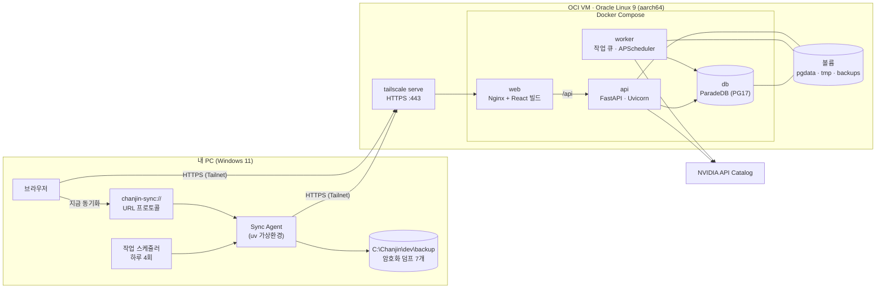
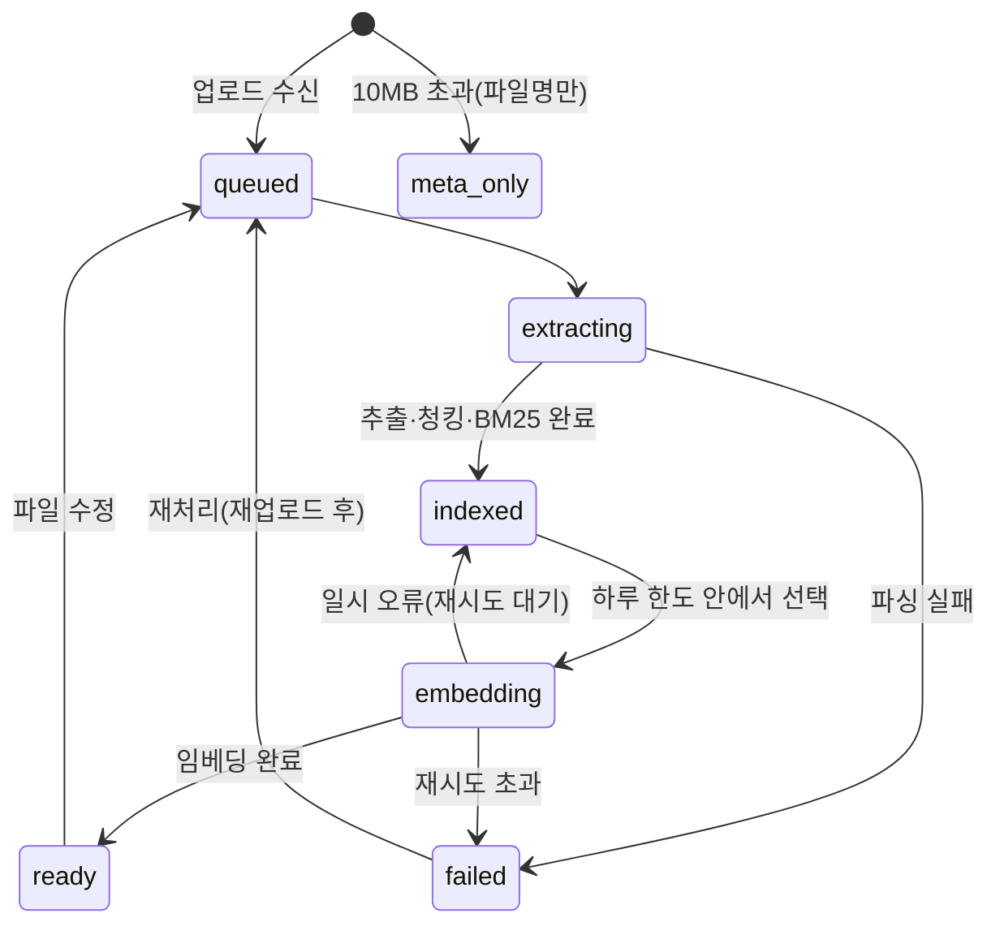
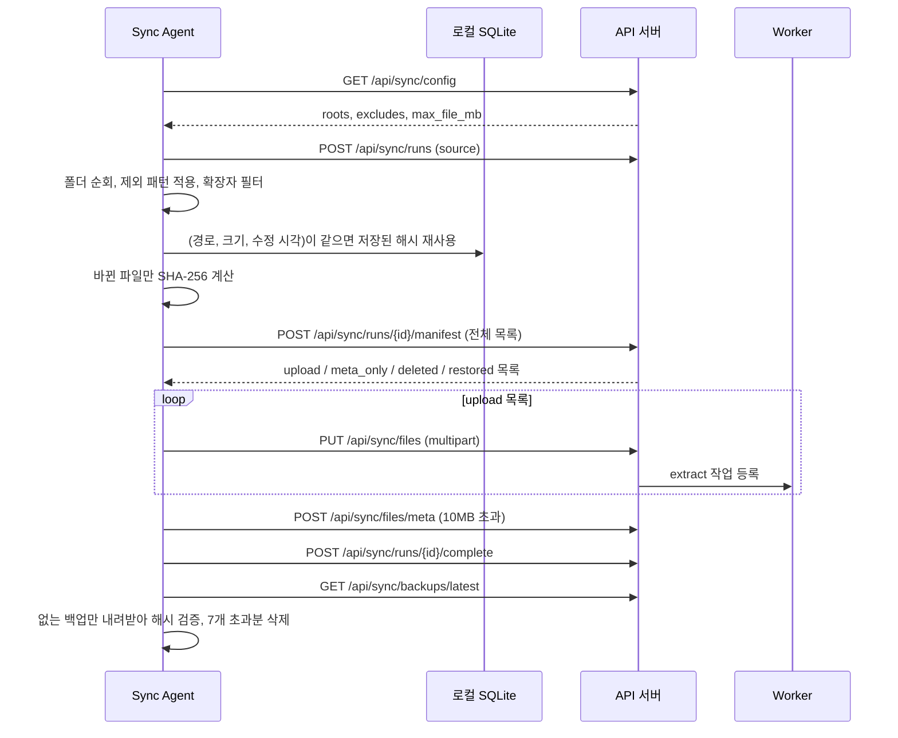

# 개인 문서 RAG 플랫폼 TRD

Nov 7, 2026 · @이찬진 · 기준 문서: [PRD.md](./PRD.md)

## 1. 개요

PRD에서 정한 기능을 어떤 기술로, 어떤 구조로 만들지 정한 기술 요구사항 문서입니다. 무엇을 만들지는 PRD를, 어떻게 만들지는 이 문서를 따릅니다. 두 문서가 어긋나면 PRD의 요구사항을 우선하고 이 문서를 고칩니다.

**설계 원칙**

- **컨테이너를 적게:** VM이 2 CPU·12GB이고 사용자가 1명이라 Redis, Celery, 별도 검색엔진을 두지 않습니다.
- **상태는 PostgreSQL 하나에:** 문서, 청크, 작업 대기열, 세션, 로그를 모두 DB에 두어 백업 하나로 복구가 끝나게 합니다.
- **arm64 우선:** 모든 이미지는 VM에서 직접 빌드하거나 arm64 공식 이미지를 씁니다.
- **모델 교체 가능:** LLM, 임베딩, 재정렬 호출은 Provider 인터페이스 뒤에 두고, 모델명과 엔드포인트는 설정값으로만 바꿉니다.

**PRD 대비 구체화한 내용**

| 항목 | 내용 |
| --- | --- |
| 웹의 "지금 동기화"(F-03) | VM은 PC를 깨울 수 없으므로, Sync Agent를 `chanjin-sync://` 사용자 지정 URL 프로토콜로 등록해 브라우저가 PC의 Agent를 직접 실행합니다 |
| 동기화 설정 위치 | 루트 폴더와 제외 패턴은 서버 DB에 저장하고, Agent가 실행할 때마다 받아 갑니다. 웹에서 바꾸면 다음 실행부터 반영됩니다 |
| 변경 판정 | Agent가 전체 목록(manifest)을 보내고 서버가 업로드 대상을 정합니다. DB를 백업에서 복구해도 차이만 다시 올라옵니다 |
| 파일 이동 | 같은 해시의 문서가 이미 있으면 업로드와 임베딩 없이 청크를 복사합니다. 하루 임베딩 한도를 쓰지 않습니다 |
| 임베딩 차원 | 4,000차원을 넘으면 halfvec도 HNSW 색인이 안 되므로, 차원 축소 또는 바이너리 양자화로 대응합니다(6.3) |

## 2. 기술 스택

| 영역 | 기술 | 용도·비고 |
| --- | --- | --- |
| 언어 | Python 3.12, TypeScript | 백엔드·Agent·평가는 Python, 웹은 TypeScript |
| 패키지 | uv(workspace, lock 파일), pnpm | |
| API 서버 | FastAPI, Uvicorn, Pydantic v2, pydantic-settings | 설정은 `.env`에서 읽습니다 |
| SSE | sse-starlette | 답변 스트리밍 |
| DB | PostgreSQL 17(ParadeDB 공식 이미지), pgvector, pg\_search | 벡터, BM25, 필터를 SQL 하나로 처리 |
| DB 접근 | SQLAlchemy 2.0(async), psycopg 3, Alembic | Hybrid 검색 SQL은 직접 작성 |
| 작업 큐 | PostgreSQL `jobs` 테이블 + `SELECT … FOR UPDATE SKIP LOCKED` | 별도 브로커 없음 |
| 예약 작업 | APScheduler(Worker 안) | 자정 한도 초기화, 매일 백업, 오래된 임시 파일 정리 |
| 질의 흐름 | LangGraph | LangChain 체인과 래퍼는 쓰지 않고 Provider를 직접 호출 |
| 모델 호출 | openai SDK(`base_url`=NVIDIA), httpx, tenacity | 재정렬은 OpenAI 호환이 아니어서 httpx로 호출 |
| 한국어 형태소 | kiwipiepy | BM25용 사전 토큰화 |
| 토큰 수 계산 | tiktoken(o200k\_base) 근사 | 청크 길이 기준. 실제 한도는 API의 `truncate=END`로 보호 |
| 문서 파서 | PyMuPDF, python-docx, openpyxl, python-pptx, lxml(HWPX), pyhwp(HWP), charset-normalizer | 3.4 참고 |
| 인증 | argon2-cffi | 비밀번호 해시 |
| 로그 | structlog(JSON, stdout) | 질의 로그는 DB에 저장 |
| CLI | Typer | 백엔드 관리, Agent, 평가 |
| 웹 | Vite, React, TypeScript, Tailwind CSS, React Router, TanStack Query, shadcn/ui | |
| 웹 부가 | react-markdown, remark-gfm, openapi-typescript | API 타입은 FastAPI OpenAPI에서 생성 |
| Sync Agent | httpx, keyring, SQLite(표준 라이브러리), pathspec, Typer | Windows 작업 스케줄러가 실행 |
| 백업 암호화 | age | VM에는 공개키만 둡니다 |
| 리버스 프록시 | Nginx | 정적 파일 서빙, `/api` 프록시 |
| 네트워크 | Tailscale(VM 호스트에 설치), `tailscale serve` | `*.ts.net` 인증서로 HTTPS |
| 배포 | Docker Compose | 이미지는 VM에서 직접 빌드 |
| 테스트·품질 | pytest, pytest-asyncio, ruff, mypy, Vitest, MSW, ESLint, Prettier | |

## 3. 시스템 구성

### 3.1 배포 구성



### 3.2 컨테이너

| 서비스 | 이미지 | 역할 | 메모리 상한(초기값) |
| --- | --- | --- | --- |
| db | ParadeDB 공식 이미지(arm64) | PostgreSQL 17 + pg\_search + pgvector | 4GB |
| api | `backend` 이미지 | REST API, SSE 답변, 업로드 수신 | 1.5GB |
| worker | `backend` 이미지(실행 명령만 다름) | 추출, 청킹, BM25 색인, 임베딩, 백업 | 3GB |
| web | Nginx(arm64) + React 빌드 결과 | 정적 파일, `/api` 프록시 | 128MB |
| migrate | `backend` 이미지(1회 실행) | `alembic upgrade head` 후 종료 | |

- `api`와 `worker`는 `migrate`가 성공한 뒤에 시작합니다(`depends_on: condition: service_completed_successfully`).
- 남는 약 3GB는 OS, Docker, Tailscale과 HNSW 색인 생성 시 여유분으로 둡니다.
- 볼륨:
  - `pgdata`: DB 데이터
  - `tmp`: 업로드 원본 임시 보관, 추출 후 삭제
  - `backups`: 암호화 덤프, VM에는 최근 3개만 유지

### 3.3 네트워크

- VM의 OCI 보안 목록은 인바운드를 모두 막습니다. Tailscale은 아웃바운드와 NAT 통과만으로 연결됩니다.
- Compose는 공개 포트를 열지 않고, `web`만 `127.0.0.1:8080`에 바인딩합니다. `tailscale serve --https=443 http://127.0.0.1:8080`으로 Tailnet 안에만 노출합니다.
- SSH는 Tailscale SSH 또는 Tailscale IP에만 바인딩한 sshd로 접속합니다.
- Tailscale ACL은 내 기기(PC, 휴대폰 등)만 VM의 443 포트에 접근하도록 제한합니다.
- 외부로 나가는 연결은 NVIDIA API(`integrate.api.nvidia.com` 등), Tailscale, OS·이미지 업데이트뿐입니다.

### 3.4 문서 파서

| 형식 | 라이브러리 | 위치 정보 | 비고 |
| --- | --- | --- | --- |
| PDF | PyMuPDF | 페이지 | 텍스트 레이어가 없는 페이지는 "스캔본 의심"으로 기록하고 건너뜁니다(OCR은 후속). AGPL이지만 배포하지 않는 개인 용도라 문제없습니다 |
| DOCX | python-docx | 제목 계층, 표 번호 | 문단 스타일(Heading 1\~n)로 제목 계층을 만들고, 표는 행 단위로 따로 추출 |
| XLSX | openpyxl(read-only, data\_only) | 시트, 행 범위 | 첫 비어 있지 않은 행을 헤더로 보고, 수식은 계산된 값으로 읽습니다 |
| PPTX | python-pptx | 슬라이드 번호 | 제목, 본문 도형, 표, 발표자 노트 순서로 추출 |
| HWPX | zipfile + lxml | 구역, 문단 | `Contents/section*.xml`의 문단과 표를 직접 해석 |
| HWP | pyhwp(hwp5txt 계열) | 문단(페이지 없음) | 품질 리스크가 가장 큰 형식입니다. 구축 초기에 내 파일로 비교합니다(13장) |
| TXT, MD | charset-normalizer | 줄 범위, MD 제목 | 한국어 Windows 파일은 cp949가 많아 인코딩을 먼저 판별합니다 |

파서는 `Parser` 인터페이스를 구현하고, 결과는 공통 형식인 `Section(location, heading_path, text, kind)` 목록으로 반환합니다. `kind`는 `text`, `table`, `slide` 중 하나입니다. 파서마다 타임아웃(60초)과 메모리 상한을 둡니다. 실패하면 사유 코드와 함께 문서를 `failed`로 기록합니다.

## 4. 저장소 구조

uv workspace 하나로 `backend`, `agent`, `eval`을 묶고, 웹은 pnpm으로 따로 관리합니다.

```
chanjin-rag/
├─ backend/                 # api, worker 공용 패키지
│  ├─ app/
│  │  ├─ api/               # FastAPI 라우터 (auth, sync, documents, chat, eval, health)
│  │  ├─ core/              # 설정, 로깅, 보안(세션, 토큰)
│  │  ├─ db/                # SQLAlchemy 모델, 세션, 검색 SQL
│  │  ├─ ingest/            # parsers/, chunking/, tokenize(Kiwi)
│  │  ├─ query/             # LangGraph 그래프, 노드, 프롬프트
│  │  ├─ providers/         # LLM, Embedding, Reranker 인터페이스와 NVIDIA 구현, Fake 구현
│  │  ├─ jobs/              # 작업 큐, Worker 루프, 예약 작업
│  │  └─ cli.py             # create-user, create-token, reindex 등
│  ├─ alembic/
│  └─ tests/
├─ agent/                   # Windows Sync Agent
│  ├─ rag_agent/            # scan, manifest, upload, backup, protocol, install
│  └─ tests/
├─ eval/                    # 평가 CLI와 평가셋
│  ├─ rag_eval/
│  └─ datasets/             # 평가셋 YAML (Git으로 관리)
├─ web/                     # Vite + React + TypeScript
├─ deploy/
│  ├─ compose.yaml
│  ├─ nginx.conf
│  ├─ postgres/             # postgresql.conf 조정값, 초기화 SQL
│  └─ scripts/              # backup, restore, deploy
├─ docs/                    # PRD.md, TRD.md
├─ .env.example
└─ pyproject.toml           # uv workspace 루트
```

## 5. 데이터 모델

모든 시각은 `timestamptz`로 저장하고, 화면과 일일 한도 계산은 `Asia/Seoul` 기준으로 합니다. 테이블과 핵심 컬럼만 적고, 상세 DDL은 Alembic 마이그레이션이 기준입니다.

### 5.1 수집

| 테이블 | 핵심 컬럼 | 설명 |
| --- | --- | --- |
| `sync_config` | `roots jsonb`, `excludes jsonb`, `max_file_mb int`(기본 10), `updated_at` | 단일 행. Agent가 실행할 때마다 받아 감 |
| `documents` | `id`, `path`, `path_key`(소문자 정규화, unique), `filename`, `ext`, `size`, `mtime`, `sha256`, `status`, `failure_code`, `failure_detail`, `content_indexed bool`, `locally_deleted bool`, `deleted_at`, `needs_upload bool`, `embed_model`, `embed_dim`, `created_at`, `updated_at` | 파일 1개 = 1행. `path`는 원래 Windows 경로를 그대로 보관 |
| `sections` | `id`, `document_id`, `seq`, `location jsonb`, `heading_path text[]`, `kind`, `text` | 추출 텍스트 원본. 재청킹은 여기서 다시 하므로 재업로드가 필요 없음 |
| `chunks` | `id`, `document_id`, `seq`, `location jsonb`, `heading_path`, `content`, `bm25_text`, `token_count`, `embedding halfvec(N)`(NULL 허용), `embed_model` | 검색 단위. `bm25_text`는 Kiwi 토큰을 공백으로 이은 문자열 |
| `jobs` | `id`, `type`, `document_id`, `status`, `priority`, `attempts`, `run_after`, `locked_at`, `last_error` | `type`: `extract`, `index`, `embed`. `priority`는 파일 수정 시각 |
| `embed_quota` | `day date`(PK), `used int` | 한국 시간 기준 날짜별 사용량. 새 날짜 행이 생기면 자연스럽게 초기화 |
| `sync_runs` | `id`, `source`(`schedule`·`web`·`cli`), `started_at`, `finished_at`, `status`, `stats jsonb` | 동기화 실행 이력. 웹의 상태 화면이 사용 |

**`location` 예시:** `{"page": 3}`, `{"sheet": "매출", "rows": [2, 41]}`, `{"slide": 7}`, `{"lines": [120, 168]}`

**문서 상태**



`locally_deleted`는 상태와 별개인 표시값입니다. 로컬에서 지워져도 검색은 되고, 결과에 "로컬 삭제됨"을 붙입니다.

### 5.2 인증

| 테이블 | 핵심 컬럼 | 설명 |
| --- | --- | --- |
| `users` | `id`, `username`, `password_hash`, `failed_logins`, `locked_until` | 1행. `backend create-user` CLI로만 생성 |
| `sessions` | `id_hash`, `user_id`, `expires_at`, `last_seen_at` | 쿠키 값의 SHA-256만 저장 |
| `api_tokens` | `id`, `name`, `token_hash`, `last_used_at`, `revoked_at` | Sync Agent용. `backend create-token` CLI로 발급 |

### 5.3 대화, 로그, 평가

| 테이블 | 핵심 컬럼 | 설명 |
| --- | --- | --- |
| `conversations` | `id`, `title`, `created_at` | F-11 |
| `messages` | `id`, `conversation_id`, `role`, `content`, `citations jsonb`, `status`, `created_at` | `citations`: 번호별 `chunk_id`, 경로, 위치, 인용 구절 |
| `query_logs` | `id`, `message_id`, `rewritten_query`, `keyword_query`, `filters`, `retrieved jsonb`, `grade`, `retried bool`, `not_found bool`, `latency_ms jsonb`, `models jsonb` | `retrieved`: 후보별 RRF 점수, 재정렬 점수, 순위. `latency_ms`: 단계별 지연 |
| `feedback` | `id`, `message_id`, `rating`(+1·-1), `note`, `failure_type` | `failure_type`: `parse`, `chunk`, `retrieval`, `rerank`, `hallucination` (F-12) |
| `eval_runs` | `id`, `dataset_version`, `git_sha`, `config jsonb`, `metrics jsonb`, `started_at`, `finished_at` | F-13 |
| `eval_results` | `run_id`, `item_id`, `retrieved jsonb`, `answer`, `scores jsonb` | 문항별 결과 |

평가셋 문항 자체는 DB가 아니라 `eval/datasets/*.yaml`에서 Git으로 관리합니다. 정답 근거는 청크 ID가 아니라 `(경로, 위치)`로 적습니다. 청킹 방식이 바뀌어 청크 ID가 달라져도 라벨을 다시 달 필요가 없습니다.

### 5.4 색인

| 대상 | 색인 | 비고 |
| --- | --- | --- |
| `chunks.embedding` | HNSW(`halfvec_cosine_ops`), `m=16`, `ef_construction=64` | 필터와 같이 쓸 때 결과가 모자라지 않게 `hnsw.iterative_scan`을 켭니다 |
| `chunks.bm25_text` | pg\_search BM25 색인, 공백(whitespace) 토크나이저 | Kiwi가 이미 토큰화했으므로 DB에서는 공백으로만 자릅니다. 함께 `filename`, `heading_path`도 색인 |
| `documents` | `path_key` unique, `sha256`, `(status)`, `(locally_deleted)` | |
| `jobs` | `(status, type, priority DESC)` | 큐 선택용 |

pg\_search의 색인 생성 문법과 토크나이저 설정은 버전마다 바뀌어 왔습니다. 구축 초기 검증(13장)에서 쓰는 이미지 버전 기준으로 확정합니다.

## 6. 수집 파이프라인

### 6.1 Sync Agent 실행 흐름



**변경 판정은 서버가 합니다.** manifest의 각 항목(`path`, `size`, `mtime`, `sha256`)을 `documents`와 비교합니다.

| 경우 | 서버 판정 |
| --- | --- |
| 새 경로이고 같은 해시가 다른 경로에 있음 | 이동으로 보고 기존 sections·chunks·임베딩을 복사. 업로드 없음, 한도 사용 없음 |
| 새 경로이거나 해시가 다름 | 10MB 이하면 `upload`, 초과면 `meta_only` |
| 해시가 같음 | 아무것도 안 함(수정 시각만 갱신) |
| `needs_upload=true`(재처리 요청된 실패 파일) | `upload` |
| DB에는 있고 manifest에 없음 | `locally_deleted=true` |
| `locally_deleted`인데 manifest에 다시 나타남 | 표시 해제(`restored`) |

**Agent 쪽 규칙**

- 동시에 한 인스턴스만 실행합니다(Windows 이름 있는 뮤텍스). 이미 실행 중이면 바로 종료합니다.
- 업로드 실패는 로컬 SQLite 재시도 큐에 남기고, 다음 실행에서 manifest 판정을 다시 받아 자연스럽게 재시도합니다.
- 기본 제외 패턴(gitignore 문법): `project/`, `backup/`, `.git/`, `node_modules/`, `.venv/`, `venv/`, `__pycache__/`, `~$*`, `*.tmp`.
- 지원 확장자(`.pdf .txt .md .docx .hwp .hwpx .xlsx .pptx`)만 manifest에 넣습니다.
- 수집 루트 밖의 경로는 심볼릭 링크라도 따라가지 않습니다.

### 6.2 Worker 처리

Worker는 하나의 프로세스에서 작업 루프와 APScheduler를 함께 돌립니다. 작업은 `SELECT … FOR UPDATE SKIP LOCKED`로 하나씩 가져가고, `locked_at`이 10분 넘게 갱신되지 않은 작업은 중단된 것으로 보고 다시 대기열에 넣습니다.

| 단계 | 작업 | 한도 | 내용 |
| --- | --- | --- | --- |
| 1 | `extract` | 없음 | 임시 원본을 파싱해 `sections`를 저장하고, 원본 파일을 삭제. 실패해도 원본은 삭제하고 `failed`와 사유를 기록 |
| 2 | `index` | 없음 | 청킹, Kiwi 토큰화, `chunks` 교체(한 트랜잭션). 이 시점부터 BM25로 검색됨. 이어서 `embed` 작업 등록 |
| 3 | `embed` | 하루 100개 파일 | 최근 수정순으로 선택. 청크를 32개씩 묶어 임베딩 API 호출 |

**하루 임베딩 한도**

- `embed` 작업을 가져갈 때 같은 트랜잭션에서 `embed_quota`의 오늘(한국 시간) `used`를 확인합니다. 100 미만일 때만 1 올리고 작업을 시작합니다.
- 한도는 작업을 가져갈 때 차감하고, 실패해도 돌려주지 않습니다. API 호출량을 넘기지 않는 것이 우선입니다.
- 한도에 도달하면 `embed` 작업은 다음 날 0시(한국 시간)까지 쉬고, `extract`와 `index`는 계속 처리합니다.
- 수정 파일의 재임베딩도 1개로 셉니다. 질문 임베딩은 세지 않습니다.
- 한도 값은 `EMBED_DAILY_FILE_LIMIT` 설정으로 바꿀 수 있습니다.

**재시도:** API 오류(429, 5xx, 타임아웃)는 tenacity로 지수 백오프합니다(최대 5회, 최대 대기 60초). 429가 계속되면 해당 작업을 `run_after`를 30분 뒤로 미뤄 반납합니다.

### 6.3 청킹과 임베딩

**청킹 규칙(PRD 5.1의 구현)**

- 같은 `heading_path` 안의 문단을 이어 붙여 500\~800토큰으로 만들고, 앞 청크 끝 10\~15%를 겹칩니다. 문단 중간에서는 자르지 않되, 한 문단이 800토큰을 넘으면 문장 단위로 자릅니다.
- 청크 앞에 `[파일명 > 제목 > 소제목]` 머리말을 붙여 임베딩합니다. 화면에 보여주는 `content`에는 넣지 않습니다.
- 표: 헤더 행 + 데이터 행 묶음(최대 약 600토큰)을 `헤더: 값 | 헤더: 값` 형태 텍스트로 바꿉니다. 청크마다 헤더를 반복합니다.
- PPTX: 슬라이드 1장 = 청크 1개(800토큰을 넘으면 나눔), 발표자 노트를 포함합니다.
- `meta_only` 문서: 파일명과 경로만 담은 청크 1개를 만들어 BM25로만 검색되게 합니다.

**임베딩 호출**

- 문서 청크는 `input_type=passage`, 질문은 `input_type=query`로 호출하고 `truncate=END`를 씁니다. 예제의 `extra_body` 형식을 그대로 따릅니다. 예제에 있던 `modality` 값은 텍스트 전용 값을 문서에서 확인해 설정합니다.
- API 키는 `os.environ["NVIDIA_API_KEY"]`로 읽습니다. 예제처럼 `"$NVIDIA_API_KEY"` 문자열을 넣으면 인증이 실패합니다.
- 청크마다 `embed_model`을 기록하고, 문서에는 모델명과 차원을 기록합니다. 설정의 모델이 바뀌면 `backend reindex --embeddings` 대상이 됩니다.

**벡터 컬럼 타입 결정**

| 실제 임베딩 차원 | 컬럼 | 색인 |
| --- | --- | --- |
| 2,000 이하 | `vector(N)` | HNSW |
| 2,001\~4,000 | `halfvec(N)` | HNSW |
| 4,000 초과 | ① API가 차원 축소(`dimensions` 등)를 지원하면 2,048 등으로 줄여 `halfvec` 사용<br/>② 안 되면 `halfvec(N)`에 저장하고, 바이너리 양자화 식(`binary_quantize`)으로 HNSW 색인을 만들어 후보를 뽑은 뒤 원래 벡터로 다시 정렬 | ① 우선 |

1,000개 파일 규모면 청크가 수만 개 수준이라, 최악의 경우 색인 없이 전수 비교해도 검색 목표(p95 500ms)를 맞출 가능성이 있습니다. 구축 초기에 실제 차원을 확인하고 표에 따라 결정합니다.

### 6.4 한국어 BM25 토큰화

- Kiwi로 형태소를 분석해 명사(NNG, NNP, NNB), 동사·형용사 어간(VV, VA), 외국어(SL), 숫자(SN), 한자(SH), 어근(XR)만 남기고 조사와 어미는 버립니다.
- 영문은 소문자로 바꾸고, 복합명사는 원형과 분해형을 모두 넣습니다(예: "위약금조항" → `위약금조항 위약금 조항`).
- 질문도 같은 함수로 토큰화합니다. 문서와 질문 토큰화가 어긋나면 BM25 품질이 바로 떨어지므로, 토큰화 함수는 하나만 둡니다.
- 사용자 사전(`deploy/kiwi_user_dict.txt`)으로 프로젝트명, 고유명사를 추가할 수 있게 합니다. 사전을 바꾸면 `backend reindex --bm25`로 다시 색인합니다(API 호출 없음).
- 평가셋으로 pg\_search 내장 한국어 토크나이저와 비교해, 더 나은 쪽을 남깁니다(PRD 9장 리스크).

## 7. 질의 파이프라인

### 7.1 LangGraph 그래프


**그래프 상태(`QueryState`):** `question`, `history`(최근 6턴), `filters`, `rewritten`, `keyword_query`, `intent`, `target_document_id`, `candidates`, `selected`, `grade`, `attempt`, `answer`, `citations`, `timings`

| 노드 | 입력 → 출력 | 구현 메모 |
| --- | --- | --- |
| rewrite | 질문·이력 → 독립 질문, 키워드 질의, 의도 | 이력이 없으면 LLM을 부르지 않고 그대로 통과(지연 절약). 출력은 JSON으로 받고, 파싱 실패 시 원문 질문 사용 |
| retrieve | 독립 질문 → 후보 30개 | 질문 임베딩과 Kiwi 토큰을 만들어 7.2의 SQL 실행 |
| rerank | 후보 30개 → 상위 8개 | `RERANK_ENABLED=false`면 RRF 상위 8개를 그대로 사용. 사용 여부는 평가셋으로 결정 |
| grade | 상위 청크 → 충분·부족 | 1차는 LLM 판정(짧은 JSON 응답). 지연이 목표를 넘으면 재정렬 점수 임계값으로 바꿉니다 |
| retry\_rewrite | 판정 사유 → 새 질의 | 동의어, 상위 개념, 키워드 위주로 바꿉니다. 재검색은 1회만 |
| generate | 선택된 청크 → 답변 | 청크를 `[1]`\~`[k]`로 번호 붙여 넣고, 문장 끝마다 인용 번호를 달게 지시. 근거 밖 지식 사용 금지 |
| summarize | 대상 문서 → 요약 | 대상은 질문에 나온 파일명이나 출처 패널의 "요약" 버튼으로 정합니다. 문서가 길면 sections를 묶어 부분 요약 후 합치기(map-reduce) |
| not\_found | → 고정 응답 | "문서에서 찾지 못했습니다"와 함께 가장 가까웠던 후보 3개를 참고로 보여줌 |
| log | 상태 → `query_logs` | 단계별 지연, 후보, 판정, 모델명 저장 |

**답변 후처리**

- 존재하지 않는 인용 번호는 지웁니다.
- 인용이 하나도 없는 답변은 근거 충실성 지표에서 실패로 셉니다.
- 모델이 추론(thinking) 텍스트를 내보내면 답변과 저장에서 제외합니다.
- LLM 설정은 PRD 검토대로 `temperature` 0\~0.3, `max_tokens` 1,024\~2,048, `stream=True`로 둡니다.

### 7.2 Hybrid 검색 SQL

벡터 상위 50개와 BM25 상위 50개를 SQL 하나 안에서 RRF(k=60)로 합칩니다. 구조는 아래와 같고, 실제 연산자와 함수명은 pg\_search 버전에 맞춥니다.

```sql
WITH vec AS (
  SELECT c.id, ROW_NUMBER() OVER (ORDER BY c.embedding <=> :qvec) AS r
  FROM chunks c JOIN documents d ON d.id = c.document_id
  WHERE c.embedding IS NOT NULL AND /* 필터 */
  ORDER BY c.embedding <=> :qvec
  LIMIT 50
),
kw AS (
  SELECT c.id, ROW_NUMBER() OVER (ORDER BY paradedb.score(c.id) DESC) AS r
  FROM chunks c JOIN documents d ON d.id = c.document_id
  WHERE c.bm25_text @@@ :qtokens AND /* 필터 */
  ORDER BY paradedb.score(c.id) DESC
  LIMIT 50
)
SELECT id,
       COALESCE(1.0 / (60 + vec.r), 0) + COALESCE(1.0 / (60 + kw.r), 0) AS rrf
FROM vec FULL OUTER JOIN kw USING (id)
ORDER BY rrf DESC
LIMIT 30;
```

- **필터:** 디렉터리(`d.path_key LIKE :prefix || '%'`), 형식(`d.ext = ANY(:exts)`), 수정일(`d.mtime BETWEEN …`). 로컬 삭제 문서는 기본으로 포함하고 표시만 합니다.
- 아직 임베딩되지 않은 청크는 `vec`에 없고 `kw`로만 들어옵니다(PRD 5.2의 "BM25로만 검색").
- 같은 문서의 청크가 상위를 독점하지 않도록, 최종 8개 선택 시 문서당 최대 3개로 제한합니다.

### 7.3 SSE 이벤트

`POST /api/conversations/{id}/messages`의 응답은 `text/event-stream`입니다.

| 이벤트 | 데이터 | 시점 |
| --- | --- | --- |
| `status` | `{"stage": "rewriting" \| "searching" \| "reranking" \| "grading" \| "retrying" \| "generating"}` | 노드 시작 시 |
| `sources` | `[{"n": 1, "chunk_id", "path", "location", "snippet", "locally_deleted"}]` | 생성 직전(출처 패널을 먼저 채움) |
| `token` | `{"text": "..."}` | 생성 중 |
| `done` | `{"message_id", "not_found", "latency_ms"}` | 완료 |
| `error` | `{"code", "message"}` | 실패(재시도 가능 여부 포함) |

- 노드 이벤트와 토큰은 LangGraph의 스트리밍(`astream`의 custom·messages 모드)으로 받아 SSE로 바꿉니다.
- Nginx는 이 경로에서 `proxy_buffering off`를 적용하고, 응답에 `X-Accel-Buffering: no`를 붙입니다.
- 클라이언트가 연결을 끊으면 생성을 중단하고, 그때까지의 답변을 `status=aborted`로 저장합니다.

### 7.4 지연 시간 예산 (p95 8초)

| 단계 | 예산 |
| --- | --- |
| rewrite(이력 있을 때만) | 1.0초 |
| 질문 임베딩 | 0.5초 |
| Hybrid SQL | 0.3초 |
| rerank | 0.8초 |
| grade | 1.0초 |
| 첫 토큰까지 | 누적 3초 이내가 목표 |
| 생성 완료 | 나머지 |

NVIDIA API 실측값(13장)이 예산을 넘으면 rewrite 생략 조건을 넓히고, grade를 재정렬 점수 임계값으로 바꾸는 순서로 줄입니다.

## 8. API 명세

모든 경로는 `/api` 아래입니다. 요청과 응답은 JSON이고, 오류는 `{"error": {"code", "message"}}` 형식입니다. 웹용 API는 세션 쿠키를, Sync API는 Bearer 토큰을 씁니다.

### 8.1 인증 (세션)

| 메서드 | 경로 | 설명 |
| --- | --- | --- |
| POST | `/auth/login` | 아이디·비밀번호 → 세션 쿠키 발급. 5회 실패 시 15분 잠금 |
| POST | `/auth/logout` | 세션 삭제 |
| GET | `/auth/me` | 로그인 상태 확인 |

### 8.2 Sync API (Bearer 토큰, Agent 전용)

| 메서드 | 경로 | 설명 |
| --- | --- | --- |
| GET | `/sync/config` | 루트, 제외 패턴, 최대 크기 |
| POST | `/sync/runs` | 실행 시작 기록(`source`) → `run_id` |
| POST | `/sync/runs/{id}/manifest` | 전체 목록 → `upload`, `meta_only`, `deleted`, `restored`, `moved` 목록 |
| PUT | `/sync/files` | multipart 업로드(`path`, `sha256`, `mtime`, `file`). 서버가 해시를 다시 계산해 검증 |
| POST | `/sync/files/meta` | 10MB 초과 파일의 경로·크기·수정 시각 |
| POST | `/sync/runs/{id}/complete` | 실행 종료와 통계 |
| GET | `/sync/backups/latest` | 최신 백업 목록(파일명, 크기, SHA-256) |
| GET | `/sync/backups/{name}` | 백업 파일 다운로드 |

### 8.3 웹 API (세션)

| 메서드 | 경로 | 설명 | 기능 |
| --- | --- | --- | --- |
| GET·PUT | `/settings/sync` | 루트, 제외 패턴 조회·수정 | F-01 |
| GET | `/sync/status` | 최근 실행, 대기열 수, 오늘 임베딩 사용량(x/100), 최근 백업 시각 | F-03, F-05 |
| GET | `/documents` | 목록(상태, 형식, 경로, 검색어 필터, 페이지네이션) | F-05 |
| GET | `/documents/{id}` | 메타데이터와 위치별 추출 텍스트 | F-10 |
| POST | `/documents/{id}/reprocess` | 실패 파일은 `needs_upload` 표시, 정상 파일은 sections에서 재청킹 | F-05 |
| GET·POST | `/conversations` | 대화 목록·생성 | F-11 |
| GET | `/conversations/{id}` | 대화와 메시지 | F-11 |
| POST | `/conversations/{id}/messages` | 질문(`text`, `filters`, `summarize_document_id?`) → SSE 응답 | F-07\~F-09 |
| POST | `/messages/{id}/feedback` | 좋아요·싫어요, 메모, 실패 유형 | F-12 |
| GET | `/eval/runs`, `/eval/runs/{id}` | 평가 실행 목록, 지표, 이전 실행과 비교 | F-13 |
| GET | `/health` | DB 연결, Worker 마지막 하트비트, 디스크 여유 | 운영 |

FastAPI의 OpenAPI 스키마에서 `openapi-typescript`로 웹의 타입을 생성합니다. API를 바꾸면 웹 타입도 같이 갱신합니다.

## 9. 프론트엔드

### 9.1 화면

| 경로 | 화면 | 주요 요소 |
| --- | --- | --- |
| `/login` | 로그인 | |
| `/` , `/c/:id` | 채팅 | 왼쪽 대화 목록, 가운데 메시지와 입력창(위에 디렉터리·형식·수정일 필터), 오른쪽 출처 패널(접기 가능) |
| `/documents` | 문서 | 상태별 탭(대기, 처리 중, BM25만, 완료, 실패, 파일명만), 실패 사유, 재처리 버튼 |
| `/documents/:id` | 문서 상세 | 위치별 추출 텍스트, 인용 위치로 스크롤·강조, "이 문서 요약" 버튼 |
| `/sync` | 동기화 | 최근 실행, 대기열, 오늘 임베딩 사용량, 최근 백업, "지금 동기화" 버튼, 루트·제외 패턴 편집 |
| `/eval` | 평가 | 실행 목록, 지표 표, 이전 실행 대비 증감 |

### 9.2 구조와 규칙

```
web/src/
├─ api/          # fetch 래퍼, 생성된 OpenAPI 타입, SSE 파서
├─ components/   # shadcn/ui 컴포넌트와 공용 컴포넌트
├─ features/     # chat/, documents/, sync/, eval/
├─ hooks/
├─ lib/
└─ routes/
```

- 서버 상태는 TanStack Query로만 관리하고, 전역 상태 라이브러리는 두지 않습니다. 필터와 패널 열림 같은 화면 상태는 URL 쿼리와 컴포넌트 상태로 처리합니다.
- **SSE 수신:** `EventSource`는 POST를 보낼 수 없으므로, `fetch`의 `ReadableStream`을 읽어 `event:`/`data:` 줄을 직접 파싱합니다. `AbortController`로 생성 중지를 지원합니다.
- **답변 렌더링:** react-markdown + remark-gfm으로 렌더링하고, `[n]`은 인용 칩으로 바꿉니다. 칩을 누르면 출처 패널의 해당 항목이 열립니다. 원시 HTML 렌더링은 끕니다.
- **API 호출:** 모든 요청은 `credentials: "include"`로 보냅니다. GET이 아닌 요청에는 `X-Requested-With: fetch` 헤더를 붙입니다(CSRF 방어, 11장).
- **로컬 경로 표시:** 출처의 `C:\…` 경로는 복사 버튼을 제공합니다. 브라우저가 로컬 파일을 직접 열 수는 없으므로 링크로 만들지 않습니다.

### 9.3 "지금 동기화" 버튼

1. 버튼을 누르면 `chanjin-sync://run?source=web`으로 이동합니다(숨긴 `<a>` 클릭).
2. 처음에는 브라우저가 "외부 프로그램 열기" 확인을 띄웁니다. "항상 허용"을 체크하면 이후에는 바로 실행됩니다.
3. 웹은 2초 간격으로 `/sync/status`를 조회합니다. 30초 안에 `source=web`인 새 실행이 생기면 진행 상태를 보여줍니다.
4. 실행이 생기지 않으면 "Agent가 설치되지 않았거나 브라우저가 실행을 막았습니다"라는 안내와 CLI 명령(`rag-agent sync`)을 보여줍니다.

## 10. Sync Agent

### 10.1 설치와 실행

`rag-agent install` 명령 하나로 아래를 모두 등록하고, `rag-agent uninstall`로 되돌립니다.

| 항목 | 내용 |
| --- | --- |
| 실행 파일 | uv 가상환경의 `pythonw.exe -m rag_agent`(콘솔 창 없이 실행) |
| 작업 스케줄러 | 하루 4회(기본 09:00, 13:00, 18:00, 22:00), "예약된 시작 시간을 놓친 경우 가능한 빨리 작업 시작", "이미 실행 중이면 새 인스턴스 시작 안 함", 사용자 로그온 상태에서만 실행 |
| URL 프로토콜 | `HKCU\Software\Classes\chanjin-sync`에 `URL Protocol` 등록, 명령은 `pythonw.exe -m rag_agent protocol "%1"` |
| 토큰 | `rag-agent login`이 토큰을 입력받아 keyring(Windows 자격 증명 관리자)에 저장 |
| 로컬 상태 | `%LOCALAPPDATA%\chanjin-rag\state.db`(SQLite), 로그는 같은 폴더의 `agent.log`(7일 순환) |

**CLI 명령:** `rag-agent sync`(수동 실행, F-03), `rag-agent status`, `rag-agent install`, `rag-agent uninstall`, `rag-agent login`, `rag-agent restore-info`(복구 안내 출력)

### 10.2 URL 프로토콜 보안

웹 페이지라면 어디서든 `chanjin-sync://` 링크를 걸 수 있으므로, Agent는 URL을 신뢰하지 않습니다.

- 허용하는 동작은 `run` 하나뿐이고, `source` 외의 매개변수는 모두 무시합니다. 경로, 명령, 서버 주소를 URL로 받지 않습니다.
- 동기화 대상과 서버 주소는 항상 로컬 설정과 서버의 `sync_config`에서 가져옵니다.
- 짧은 시간에 반복 호출되면(1분 안에 2회 이상) 무시합니다.
- 최악의 경우에도 "평소의 동기화를 한 번 더 실행"하는 것 이상의 일이 일어나지 않게 합니다.

### 10.3 백업 수신

- 동기화가 끝나면 `/sync/backups/latest`를 조회합니다. `C:\Chanjin\dev\backup`에 없는 파일만 내려받습니다.
- 내려받은 뒤 SHA-256을 검증하고, 실패하면 파일을 지우고 다음 실행에서 다시 받습니다.
- 날짜순으로 7개를 넘는 오래된 파일은 삭제합니다.
- 이 폴더는 기본 제외 패턴(`backup/`)에 들어 있어 다시 업로드되지 않습니다.

## 11. 보안

| 영역 | 구현 |
| --- | --- |
| 네트워크 | 공인 인바운드 없음, Tailnet 안에서 HTTPS(`tailscale serve`), Tailscale ACL로 내 기기만 허용 |
| 웹 세션 | 32바이트 난수 쿠키 `sid`, `HttpOnly`·`Secure`·`SameSite=Strict`, 14일 슬라이딩 만료, DB에는 해시만 저장 |
| CSRF | `SameSite=Strict`에 더해, GET이 아닌 요청은 `X-Requested-With` 헤더와 `Origin` 검사 |
| 비밀번호 | argon2id 해시, 5회 실패 시 15분 잠금 |
| Agent 토큰 | 32바이트 난수, DB에는 해시만 저장, PC에서는 keyring에 보관, 폐기 가능(`revoked_at`) |
| 업로드 | 경로는 `sync_config`의 루트 안인지 서버에서 다시 검증, 크기 상한(Nginx `client_max_body_size 12m`), 확장자 화이트리스트, 해시 재검증 |
| 파서 격리 | 파싱은 Worker의 하위 프로세스에서 타임아웃과 메모리 상한을 두고 실행. 실패해도 Worker 본체는 유지 |
| 비밀값 | `.env`(권한 600)에만 두고 Git에는 `.env.example`만 올립니다. 대상: `NVIDIA_API_KEY`, `DATABASE_URL`, `BACKUP_AGE_RECIPIENT`(공개키) |
| 저장 데이터 | OCI 부트 볼륨 기본 암호화. 원본은 추출 직후 삭제. 백업은 age로 암호화하고 개인키는 PC에만 보관 |
| 로그 | API 키, 쿠키, 토큰은 기록하지 않습니다. 청크 본문은 애플리케이션 로그에 남기지 않고, 질의 로그(DB)에만 저장 |
| 외부 전송 | NVIDIA API에는 청크와 질문 텍스트만 보냅니다. 파일 경로는 프롬프트의 출처 표기용으로만 넣습니다 |

## 12. 운영

### 12.1 설정값

| 변수 | 기본값 | 설명 |
| --- | --- | --- |
| `NVIDIA_API_KEY` | | 필수 |
| `NVIDIA_BASE_URL` | `https://integrate.api.nvidia.com/v1` | |
| `LLM_MODEL` | `deepseek-ai/deepseek-v4.1-flash` | |
| `EMBED_MODEL` | `nvidia/nemotron-3.5-embed-8b` | |
| `RERANK_MODEL`, `RERANK_URL` | Nemotron 3.5 Rerank 8B | 엔드포인트는 모델 페이지 기준으로 설정 |
| `RERANK_ENABLED` | `true` | 평가 결과로 결정 |
| `EMBED_DAILY_FILE_LIMIT` | `100` | |
| `EMBED_BATCH_SIZE` | `32` | |
| `TZ` | `Asia/Seoul` | 한도 초기화와 예약 작업 기준 |
| `BACKUP_AGE_RECIPIENT` | | age 공개키 |
| `BACKUP_KEEP_ON_VM` | `3` | |

### 12.2 백업과 복구

- **매일 03:00(한국 시간):** Worker의 APScheduler가 `pg_dump -Fc` 결과를 `age -r <공개키>`로 암호화합니다. 파일명은 `backups/rag-YYYYMMDD.dump.age`이고, VM에는 최근 3개만 둡니다. 이를 위해 `backend` 이미지에 PostgreSQL 17 클라이언트를 넣습니다.
- **PC 보관:** Sync Agent가 실행될 때마다 내려받아 7개를 보관합니다(10.3).
- **복구 절차(`deploy/scripts/restore.sh`):**
  1. 새 VM에 Compose를 띄웁니다. 이때 `db`만 띄웁니다.
  2. PC에서 백업 파일을 VM으로 복사합니다(Tailscale `scp`).
  3. `age -d -i 개인키`로 복호화합니다. 개인키는 PC에서만 쓰므로 복호화는 PC에서 하고 평문 덤프를 옮기는 방법도 허용합니다.
  4. `pg_restore`로 복원한 뒤 `api`와 `worker`를 띄웁니다.
  5. 다음 Agent 실행에서 manifest 비교로 백업 이후 바뀐 파일만 다시 올라옵니다.
- **복구 훈련:** 구축 단계에서 한 번 실제로 복구해 절차를 확인합니다.

### 12.3 배포

- VM에서 `git pull` → `docker compose build` → `docker compose up -d` 순서로 배포합니다. arm64 이미지를 VM에서 직접 빌드하므로 크로스 빌드와 레지스트리가 필요 없습니다.
- DB 스키마는 `migrate` 서비스가 `alembic upgrade head`로 올립니다. 되돌리기 어려운 마이그레이션 전에는 수동 백업을 먼저 받습니다.
- 개발은 Windows PC의 Docker Desktop에서 같은 Compose 파일로 `db`만 띄우고, `api`와 `worker`는 uv로 직접 실행합니다.

### 12.4 모니터링

- `/health`가 DB 연결, Worker 하트비트(30초마다 DB에 기록), 디스크 여유(10GB 미만이면 경고)를 반환합니다.
- 동기화 화면에 마지막 성공 동기화 시각과 마지막 백업 시각을 표시합니다. 하루 넘게 갱신되지 않으면 경고 배지를 띄웁니다.
- 별도 모니터링 시스템은 두지 않습니다.

### 12.5 리소스 예산

| 항목 | 예상 |
| --- | --- |
| 디스크(47GB) | OS 약 10GB, Docker 이미지 약 5GB, DB 수 GB(청크 수만 개 × 벡터 + HNSW + 추출 텍스트), VM 백업 3개, 나머지는 여유 |
| PostgreSQL | `shared_buffers=1GB`, `maintenance_work_mem=1GB`(HNSW 생성), `work_mem=32MB` |
| Worker 동시성 | 파싱은 1개씩(CPU 2개), 임베딩 API 호출은 동시 2개 |
| API | Uvicorn 프로세스 1개(async), SSE 연결은 사용자 1명 기준 |

## 13. 구축 초기 검증

본격 개발 전에 아래를 먼저 확인합니다. 결과에 따라 이 문서의 해당 절을 고칩니다.

| 순서 | 확인 항목 | 통과 기준 | 실패 시 |
| --- | --- | --- | --- |
| 1 | ParadeDB 이미지의 arm64 동작, pg\_search와 pgvector 동시 사용, 공백 토크나이저 | Oracle Linux 9 VM에서 BM25 + 벡터 RRF 쿼리 실행 성공 | 공식 PostgreSQL + pgvector 이미지로 바꾸고 BM25는 애플리케이션 내 색인(bm25s) |
| 2 | 임베딩 실제 차원, 한 요청당 최대 입력 수, `modality` 값 | 차원 확인 후 6.3 표대로 컬럼 타입 확정 | 6.3 ②, 또는 색인 없는 전수 비교 |
| 3 | NVIDIA API 지연, 429 동작과 응답 헤더, 재정렬 엔드포인트, deepseek의 추론 텍스트 출력 여부 | 7.4 예산 안 | 7.4의 줄이는 순서 적용 |
| 4 | 내 HWP/HWPX 파일 10개 이상 파싱 품질 | 본문과 표 텍스트 누락 없음 | 다른 HWP 파서 비교, 실패 사유 기록 후 후속 과제로 |
| 5 | OCI 프리 티어 유휴 인스턴스 회수 조건 | 이 플랫폼의 평소 부하로 회수 조건에 걸리지 않음 | 계정 유형 변경 검토, 백업 주기 확인 |
| 6 | `tailscale serve` HTTPS, Chrome·Edge의 `chanjin-sync://` 실행 | 웹 버튼으로 Agent 실행, Secure 쿠키 동작 | 웹 버튼은 안내만 표시하고 CLI 사용 |
| 7 | 백업 → 새 DB 복구 | 복구 후 검색 결과 동일 | 절차 수정 |

## 14. 테스트 전략

| 수준 | 대상 | 방법 |
| --- | --- | --- |
| 단위 | 형식별 파서, 청커, Kiwi 토큰화, RRF 합산, 인용 후처리, manifest 판정, 제외 패턴 | pytest, `backend/tests/fixtures`에 형식별 샘플 파일(HWP 포함) |
| 통합 | Hybrid SQL, 작업 큐와 일일 한도, 청크 교체 트랜잭션 | Docker의 ParadeDB 테스트 DB에 pytest 실행 |
| API | 인증, Sync API, SSE 이벤트 순서 | httpx `AsyncClient`, Provider는 Fake 구현(고정 벡터·고정 답변) |
| Agent | 스캔, 해시 캐시, 재시도 큐, 프로토콜 인자 검증 | 임시 폴더와 가짜 서버 |
| 웹 | SSE 파서, 인용 칩, 동기화 버튼 흐름 | Vitest + MSW |
| 품질 회귀 | 검색·답변 지표 | `rag-eval run`(평가셋 30\~50문항, PRD 8장 지표). 청킹, 프롬프트, 모델, 재정렬 설정을 바꿀 때마다 실행해 이전 실행과 비교 |

**평가 CLI(`rag-eval`) 규칙**

- **Recall@5, MRR:** 정답 근거를 `(경로, 위치)` 겹침으로 판정합니다.
- **근거 충실성, 답변 정확도:** LLM-as-judge로 판정합니다. 판정 모델은 답변 모델(deepseek)과 다른 계열의 NVIDIA 카탈로그 모델로 정하고, 판정 모델 이름을 `eval_runs.config`에 기록합니다.
- **결과 저장:** `eval_runs`와 `eval_results`에 저장하고, `/eval` 화면과 CLI에서 이전 실행과 비교합니다.
- **임베딩 한도:** 평가 실행 중의 질문 임베딩은 한도에 세지 않습니다.
